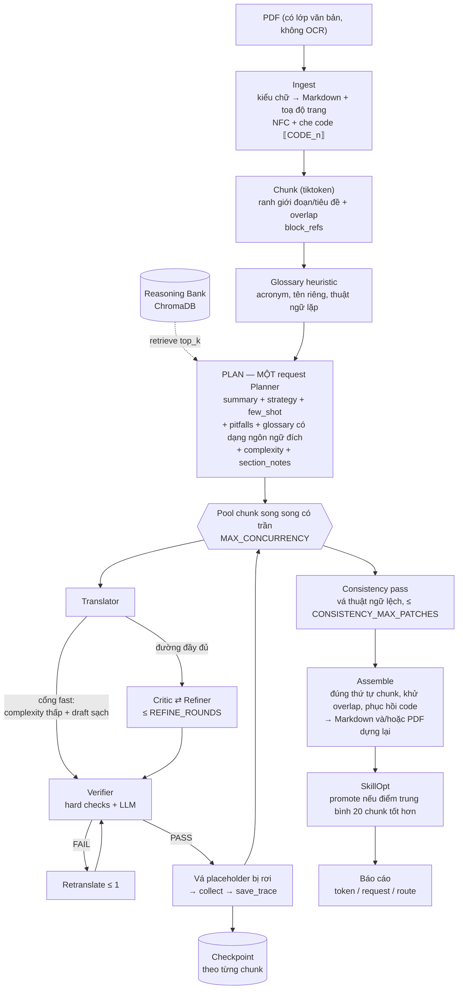

# polyglot-lc

**CLI dịch máy đa tác tử, ngữ cảnh dài** — dựng trên một đồ thị điều phối LLM
(LangGraph), một **Reasoning Bank** bền vững (ChromaDB) và **SkillOpt** (tối ưu
prompt dịch bằng "textual gradient").

Đầu vào là **PDF có lớp văn bản** (không OCR). Đầu ra chọn được: **Markdown** như
trước, **PDF dựng lại giữ nguyên định dạng** (bố cục, ảnh, đồ hoạ, bảng biểu của
trang gốc được giữ; chỉ chữ đã dịch được thay tại chỗ), hoặc **cả hai**.

Mỗi giai đoạn đều có một chủ sở hữu rõ ràng: prompt nào nằm cùng file với bộ
parse của nó, nhờ vậy sửa một prompt không thể âm thầm làm lệch một parser ở
file khác.

---

## 1. Kiến trúc



Sơ đồ dạng text cho terminal:

```
 PDF ──Ingest──▶ NFC + che code + toạ độ ──▶ Chunk (tiktoken, overlap)
                                   │
                                   ▼
   Reasoning Bank ◀──retrieve──  PLAN: MỘT request Planner duy nhất
                                   │  summary + strategy + few_shot + pitfalls
                                   │  + glossary (kèm dạng ngôn ngữ đích)
                                   │  + complexity + ghi chú từng phần
                                   ▼
   ┌──────── pool chunk song song (MAX_CONCURRENCY) ────────────────┐
   │  Translator ─┬─ fast ──────────────────────────────────────────┼─▶ Verifier
   │              └─ full ─▶ Critic ─▶ [Refiner ─▶ Critic] × rounds │
   │  Verifier ──FAIL──▶ Retranslate (≤1) ──▶ Verifier             │
   │  PASS ─▶ vá placeholder ─▶ collect ─▶ save_trace ─▶ checkpoint │
   └───────────────────────────┬───────────────────────────────────┘
                               ▼
        Consistency pass (vá thuật ngữ, có trần)
                               ▼
        Assemble + phục hồi code ─▶ SkillOpt ─▶ báo cáo
          (skills/<src>-<tgt>/<domain>.json)
```

### Hợp đồng của từng giai đoạn

| # | Giai đoạn | Chủ sở hữu | Gọi model? | Kết quả |
|---|---|---|---|---|
| 1 | `ingest` | `ingest/` | không | `Document` (block + `code_map` + toạ độ trang) |
| 2 | `detect_lang` | `pipeline/coordinator` | không | mã ngôn ngữ nguồn (`langdetect`) |
| 3 | `segment` | `segment/chunker` | không | `Chunk[]` + `block_refs` |
| 4 | `glossary` | `segment/glossary` | không | thuật ngữ heuristic + CSV người dùng |
| 5 | `plan` | `analysis/unified_planner` | **1 request** | `DocumentPlan` |
| 6 | `analyse_chunks` | `analysis/complexity` | không | điểm phức tạp mỗi chunk |
| 7 | mỗi chunk | `orchestrator/graph` | 1–5 request | bản dịch + `path` |
| 8 | `consistency` | `pipeline/consistency` | ≤ trần | bản vá thuật ngữ |
| 9 | `assemble_output` | `pipeline/assembler`, `pipeline/pdf_output` | không | tài liệu cuối (Markdown và/hoặc PDF) |
| 10 | `skillopt_update` | `skillopt/` | 1 request | kỹ năng (có thể) được promote |

Không có bước nào trong pipeline phụ thuộc vào việc một bước "best-effort" phải
thành công: Reasoning Bank, SkillOpt, kiểm tra tính nhất quán và việc dựng lại
PDF đều suy giảm êm thay vì làm sập cả lượt chạy — một lần dựng PDF lỗi vẫn để
lại bản Markdown đã dịch xong.

---

## 2. Tính năng

- **Bố cục tác tử lai**: 5 vai trò LLM có cấu hình riêng (Planner / Translator /
  Critic / Refiner / Verifier) cộng **Consistency editor** dùng chung cấu hình
  `REFINER` nên không cần thêm biến môi trường. Translator, Critic và Refiner
  hợp thành **nhóm đọc-nguồn** và chia sẻ một provider/model (`SOURCE_GROUP_*`),
  vì cả ba đều đọc lại đúng chunk nguồn đó. Planner và Verifier độc lập, giữ
  riêng `PLANNER_*` / `VERIFIER_*`. Bất kỳ giá trị `<NAME>_*` nào cũng ghi đè
  nhóm — trộn OpenAI, DeepSeek, proxy tương thích Anthropic, Ollama, vLLM… tuỳ ý.
- **Prompt caching gốc của provider**: nhóm đọc-nguồn gửi một tiền tố ổn định
  giống hệt nhau (văn bản gốc + glossary + strategy) lên **đầu tiên**, phần động
  đặt sau, để provider cache được khối dùng chung. Số liệu cache từ OpenAI
  (`prompt_tokens_details.cached_tokens`), DeepSeek (`prompt_cache_hit_tokens`)
  và dạng Anthropic (`cache_read_input_tokens`) được báo cáo riêng.
  `PROMPT_CACHE=explicit` mới phát thêm breakpoint `cache_control`.
- **Chỉ PDF, một bộ trích xuất duy nhất**: `ingest/pdf_layout.py` đọc trực tiếp
  kiểu chữ của PDF (run đơn cách là code, run quá cỡ là tiêu đề, khoảng hở glyph
  là chỗ ngắt từ) rồi phát ra Markdown có cấu trúc thật. `markitdown` và tầng dự
  phòng `pypdf → pdfplumber` đã bị bỏ: đầu vào là PDF có lớp văn bản, không OCR.
  Mỗi block còn mang **toạ độ trang** nơi nó được đọc ra, nên cùng một bản dịch có
  thể được dựng lại thành PDF đúng bố cục mà không phải trích xuất lần hai.
- **Ba kiểu đầu ra**: `md` (mặc định, như trước), `pdf` — dựng lại trang gốc với
  chữ đã dịch, giữ nguyên khổ trang, ảnh, đồ hoạ vector và đường kẻ bảng, nhúng
  font Unicode có dấu tiếng Việt và tự thu nhỏ cỡ chữ cho vừa khung — và `both`.
  Chọn bằng `--format` trên CLI, một lựa chọn ba chiều trong web UI, hay `OUTPUT_FORMAT`
  trong `.env`. Bảng và code được **giữ nguyên bản gốc** trong PDF (ý nghĩa của
  bảng nằm ở lưới cột, còn code vốn không được dịch); hai loại đó vẫn được dịch
  đầy đủ trong đầu ra Markdown.
- **Chia đoạn theo ngữ cảnh dài**: chunk theo token (tiktoken, ngân sách lấy từ
  `TRANSLATOR_MODEL`) tại ranh giới đoạn/tiêu đề, có overlap và `block_refs` để
  hợp nhất khử trùng.
- **Plan tài liệu trong một lần gọi**: toàn bộ giai đoạn planner — tóm tắt tài
  liệu, strategy, few-shot, pitfalls, thuật ngữ *kèm dạng ngôn ngữ đích*, độ
  phức tạp và ghi chú từng phần — là **một** request. `UNIFIED_PLANNER=0` khôi
  phục luồng summary-tree cũ. Đo trên tài liệu 20 chunk (LLM_MOCK):

  | | request Planner | tổng request |
  |---|---|---|
  | unified (mặc định) | **1** | **61** |
  | legacy (`UNIFIED_PLANNER=0`) | 22 | 82 |

  Tức 21 request Planner và ~26% tổng request được cắt bỏ trước khi chunk đầu
  tiên được dịch.
- **Pipeline chất lượng thích ứng**: mỗi chunk được chấm cục bộ (cấu trúc, độ
  dài, placeholder, mật độ thuật ngữ) và draft được kiểm bằng đúng những cổng
  tất định mà Verifier dùng. Chunk đơn giản có draft sạch đi **thẳng tới
  Verifier**, bỏ qua Critic và Refiner; chunk đáng ngờ chạy vòng
  Critic → Refiner đầy đủ. `FAST_PATH_SKIP_LLM_VERIFY=1` bỏ luôn lần gọi
  Verifier trả phí khi các kiểm tra cứng đã qua. Định tuyến tốn **0 token**.
- **Checkpoint chống sập**: mỗi chunk xong được ghi vào
  `<CHECKPOINT_DIR>/<job>/<chunk>.json`; `--resume` bỏ qua các chunk đã xong
  (một lượt resume trọn vẹn tốn 0 request). Checkpoint gắn với đường dẫn/size/
  mtime của file, cặp ngôn ngữ, domain, model Translator và hash của chunk, nên
  đổi input hay đổi `--max-tokens` không bao giờ dùng lại kết quả cũ.
  `PARTIAL_OUTPUT=1` còn ghi lại file đầu ra khi từng chunk hoàn thành.
- **Một chunk lỗi không làm mất cả lượt chạy**: lỗi nhà cung cấp ở một chunk
  được ghi lại và bỏ qua, chunk đó để trống trong output dưới dạng marker
  `<!-- chunk-001: untranslated (source blocks 4-6 lost) -->` kèm số khối nguồn
  không nơi nào khác chứa, và lỗi vẫn xuất hiện trong báo cáo cuối.
- **Nhất quán xuyên chunk**: sau khi dịch, glossary đã lên kế hoạch được áp lên
  toàn tài liệu. Chunk đi lệch được **vá** (giới hạn bởi `CONSISTENCY_MAX_PATCHES`,
  mặc định 5) thay vì dịch lại, và bản vá chỉ được giữ nếu nó thật sự đưa đúng
  thuật ngữ đã định vào. Một "lệch đồng loạt" (không chunk nào dùng thuật ngữ dự
  kiến) được báo cáo chứ không vá, vì không có gì để các chunk thống nhất *theo*.
- **Sửa placeholder tất định**: code không bao giờ tới model — nó được che thành
  `⟦CODE_n⟧` và hoàn trả nguyên văn khi hợp nhất. Vì `restore_code` chỉ là
  `str.replace`, một marker bị model làm rơi sẽ **âm thầm** xoá cả khối code;
  `pipeline/placeholders.py` chèn lại marker vào đúng vị trí đoạn của nó trước
  khi chunk được checkpoint.
- **Glossary**: acronym, cụm viết hoa, thuật ngữ lặp ≥ 2 lần, cộng CSV người
  dùng. Planner bổ sung dạng ngôn ngữ đích; CSV của người dùng luôn thắng.
- **Reasoning Bank** (ChromaDB): trace bền vững `{strategy, few_shot, pitfalls,
  score, ts…}`, chỉ upsert khi score ≥ 0.75. Tự reset collection khi số chiều
  embedding đổi (đổi `EMBED_MODEL`, vào/ra mock).
- **SkillOpt**: thu thập (prompt, output, điểm) theo từng chunk; Planner đề xuất
  textual gradient; kỹ năng chỉ được promote khi điểm trung bình 20 chunk gần
  nhất **thắng** kỹ năng đang dùng.
- **Hàng đợi theo từng provider**: tối đa `LLM_PROVIDER_CONCURRENCY` (mặc định
  **1**) request đang bay cho mỗi `base_url`, để gói miễn phí chỉ phục vụ một
  request không bị pool chunk giẫm lên. Đây là **hàng đợi**, không phải van: các
  lời gọi xếp hàng chờ lượt thay vì thất bại, thời gian xếp hàng không bị tính
  vào deadline của chính request đó, và slot được trả lại kể cả khi request lỗi.
- **Timeout theo yêu cầu có trần**: mọi lời gọi LLM/embedding bị chặn bởi
  `LLM_TIMEOUT` (mặc định 45s), ghi đè theo từng agent bằng `<NAME>_TIMEOUT`
  (ví dụ `VERIFIER_TIMEOUT`) hoặc `EMBED_TIMEOUT`. SDK `timeout` là *read*
  timeout (mỗi byte tới lại reset nó), nên còn một **deadline wall-clock thật**
  ở trên nó: một endpoint treo sẽ thành lỗi timeout có thể retry trong vòng vài
  chục giây thay vì treo tiến trình hàng chục phút. Verifier suy giảm êm.
- **Retry có kiểm soát**: lỗi hạ tầng (429/408/timeout/5xx/lỗi kết nối) retry
  theo backoff lũy thừa + jitter giới hạn (`LLM_RETRY_JITTER`) và tôn trọng
  `Retry-After`. Một 429 kiểu "vẫn còn request đang chạy" được thử lại sau **ít
  nhất** `LLM_RETRY_CONCURRENCY_WAIT` (mặc định 10s), vì backoff 2s chỉ đâm vào
  chính request đang chạy phía server; jitter được **cộng lên trên** sàn đó chứ
  không trừ xuống. Lỗi ngữ nghĩa (Verifier FAIL) dùng một nhánh retranslate
  riêng, có giới hạn.
- **Cổng thích ứng cho Refiner**: `REFINE_MIN_SCORE` bỏ qua Refiner với draft đã
  đủ điểm (mặc định bằng `CRITIC_THRESHOLD`, nên hành vi không đổi trừ khi nâng
  lên).
- **Quan sát cache**: mỗi request được gắn `HIT` / `MISS` / `UNKNOWN` **chỉ** từ
  metadata của provider (thiếu metadata không bao giờ bị tính là miss), kèm tổng
  token input đã cache / chưa cache và một fingerprint debug của tiền tố ổn định.
- **CLI đơn giản, không động**: mỗi bước một dòng (`[3] Running critic
  (chunk-000) ...`), rồi một báo cáo token/request gọn (input, cached input,
  uncached input, output, tổng, request — kèm bảng theo provider/model). Không
  spinner, không progress bar, không dashboard vẽ lại. Sự kiện có cấu trúc vẫn
  được ghi ra `logs/run_<ts>.jsonl`.
- **Song song có trần**: các chunk độc lập chạy song song tối đa
  `MAX_CONCURRENCY` (mặc định 2), mỗi chunk giữ nguyên thứ tự nội bộ
  Translate → [Critic → Refiner] → Verify. Output luôn được hợp nhất theo thứ tự
  chunk gốc bất kể thứ tự hoàn thành.
- **Cổng chất lượng**: kiểm tra cứng tất định (placeholder `⟦CODE_n⟧`, cấp tiêu
  đề) + phán quyết LLM; Verifier fail kéo theo một lần dịch lại có kèm lý do.
  Lỗi cấu trúc chặn **trước** lời gọi Verifier trả phí.

---

## 3. Cài đặt

Yêu cầu Python 3.11+.

```bash
python -m venv .venv
# Linux/macOS:  source .venv/bin/activate
# Windows:      .venv\Scripts\Activate.ps1

pip install -e ".[dev]"        # hoặc: uv pip install -e ".[dev]"
```

## 4. Cấu hình

Sao chép `.env.example` → `.env` và điền cấu hình theo từng tác tử:

```dotenv
PLANNER_BASE_URL=https://api.openai.com/v1
PLANNER_MODEL=gpt-4o-mini
PLANNER_API_KEY=sk-...
PLANNER_TEMPERATURE=0.2

# Nhóm đọc-nguồn: Translator + Critic + Refiner dùng chung một provider.
SOURCE_GROUP_BASE_URL=https://api.openai.com/v1
SOURCE_GROUP_MODEL=gpt-4o
SOURCE_GROUP_API_KEY=sk-...
SOURCE_GROUP_TEMPERATURE=0.3

VERIFIER_BASE_URL=https://api.openai.com/v1
VERIFIER_MODEL=gpt-4o-mini
VERIFIER_API_KEY=sk-...

EMBED_BASE_URL=https://api.openai.com/v1
EMBED_MODEL=text-embedding-3-small
EMBED_API_KEY=sk-...
```

Thiếu key bắt buộc sẽ báo lỗi rõ ràng trên **Errors panel** — không có gì bị
hard-code, mọi thứ đến từ env.

### Nhóm biến

| Nhóm | Biến |
|---|---|
| Tác tử | `<NAME>_BASE_URL`, `_MODEL`, `_API_KEY`, `_TEMPERATURE`, `_TIMEOUT` với `NAME` ∈ PLANNER/TRANSLATOR/CRITIC/REFINER/VERIFIER |
| Nhóm đọc-nguồn | `SOURCE_GROUP_BASE_URL`, `_MODEL`, `_API_KEY`, `_TEMPERATURE` |
| Endpoint dự phòng | `<NAME>_BACKUP_BASE_URL`, `_BACKUP_MODEL`, `_BACKUP_API_KEY` (cần cả hai biến đầu) |
| Embedding | `EMBED_BASE_URL`, `EMBED_MODEL`, `EMBED_API_KEY`, `EMBED_TIMEOUT` |
| Đường dẫn | `REASONING_BANK_PATH`, `SKILLS_DIR`, `LOGS_DIR`, `LOG_JSONL`, `CHECKPOINT_DIR` |
| Chia đoạn | `CHUNK_MAX_TOKENS`, `CHUNK_OVERLAP_TOKENS`, `MAX_CONCURRENCY` |
| Chất lượng | `CRITIC_THRESHOLD`, `REFINE_ROUNDS`, `REFINE_MIN_SCORE`, `RB_TOP_K` |
| Luồng | `UNIFIED_PLANNER`, `SUMMARY_TREE_CHUNK_SUMMARIES`, `ADAPTIVE_QUALITY`, `FAST_PATH_MAX_COMPLEXITY`, `FAST_PATH_MIN_SCORE`, `FAST_PATH_SKIP_LLM_VERIFY` |
| Bền vững | `RESUME`, `PARTIAL_OUTPUT` |
| Đầu ra | `OUTPUT_FORMAT` (`md` \| `pdf` \| `both`), `PDF_FONT_PATH` |
| Nhất quán | `CONSISTENCY_CHECK`, `CONSISTENCY_MAX_PATCHES` |
| Retry / timeout | `LLM_MAX_RETRIES`, `LLM_TIMEOUT`, `LLM_RETRY_BASE_DELAY`, `LLM_RETRY_MAX_DELAY`, `LLM_RETRY_BUFFER_SECONDS`, `LLM_RETRY_JITTER`, `LLM_PROVIDER_CONCURRENCY`, `LLM_RETRY_CONCURRENCY_WAIT` |
| Cache | `PROMPT_CACHE` (`auto` \| `explicit` \| `off`) |
| Debug / demo | `LLM_MOCK`, `LLM_VERBOSE`, `LLM_VERBOSE_RESILIENCE` |

Hai biến chưa có trong `.env.example` (đọc thẳng từ môi trường):
`LLM_PROVIDER_CONCURRENCY` và `LLM_RETRY_CONCURRENCY_WAIT`.

### Chế độ demo / offline không cần key

Đặt `LLM_MOCK=1` để chạy toàn bộ pipeline với mock tất định trong tiến trình
(không key, không mạng). Embedding tự lùi về vector hash tất định khi endpoint
không tới được.

## 5. Sử dụng

```bash
polyglot translate --file input/handbook.pdf --src en --tgt vi
# Dựng lại PDF đúng bố cục, và ghi thêm bản Markdown cạnh nó:
polyglot translate --file report.pdf --src auto --tgt en --domain legal \
    --glossary glossary.csv --out report.en.md --format both --max-tokens 512
```

| Tuỳ chọn | Mô tả |
|---|---|
| `--file / -f` | **File PDF đầu vào** (phải có lớp văn bản; không OCR) |
| `--src / -s` | Ngôn ngữ nguồn, `auto` = langdetect |
| `--tgt / -t` | Mã ngôn ngữ đích |
| `--domain / -d` | Gợi ý domain (tech, legal…) dùng cho Planner/RB/SkillOpt |
| `--glossary / -g` | CSV glossary `src,tgt` mỗi dòng |
| `--out / -o` | Đường dẫn gốc của đầu ra: `<gốc>.md` và/hoặc `<gốc>.pdf` (mặc định `<stem>.<tgt>.md`) |
| `--format / -F` | `md` (mặc định) \| `pdf` (dựng lại PDF giữ định dạng) \| `both` (env: `OUTPUT_FORMAT`) |
| `--max-tokens / -m` | Ghi đè ngân sách token mỗi chunk |
| `--quiet / -q` | Chỉ in báo cáo cuối, không in từng bước |
| `--resume / --no-resume` | Dùng lại checkpoint của lượt chạy bị gián đoạn (env: `RESUME`) |
| `--checkpoint-dir` | Nơi lưu checkpoint theo chunk (env: `CHECKPOINT_DIR`) |
| `--run-id` | Tên của lượt chạy này (mặc định: `RUN_ID` từ môi trường, không thì tự sinh) |

Báo cáo cuối in ra: số chunk, điểm critic trung bình (đánh dấu *est.* khi không
có Critic nào chạy), số lần retry, số trace đã lưu, việc promote kỹ năng, số
chunk đã đi mỗi đường **fast / standard / deep** (kèm lý do khi fast path bị từ
chối), số request Planner, số thuật ngữ glossary, số chunk resume, số bản vá
nhất quán, file đầu ra, file PDF (kèm số block đã dựng lại), đường dẫn log JSONL
và bảng token/request.

### Đọc lại một lượt chạy

```bash
polyglot trace                          # lượt mới nhất dưới logs/
polyglot trace 20261012_015104_dad6b2    # theo run id
polyglot trace logs/webui/<id>/run_*.jsonl --json
```

Lệnh in ra: cài đặt lượt chạy (file, `sha256`, `plan_hash`, ngôn ngữ, max token,
từng agent + host), dòng thời gian theo từng khối (đã đi đường nào **và vì sao**,
thời lượng và token từng bước), các vấn đề kèm `cause`, và tổng kết
(token/request/cache/retry, file sinh ra, thống kê dựng lại PDF). Không có đối số
thì nó quét đệ quy `logs/` — kể cả lượt do web UI chạy, vốn nằm trong thư mục
riêng của nó. Đọc một lượt đã hỏng là việc bình thường: lệnh thoát 0 và nói rõ
lượt đó không để lại bản ghi nào.

Ghi chú trace là **chỉ metadata**: id, hash, độ dài, số token, thời lượng, quyết
định + lý do, nguyên nhân lỗi. Không có văn bản tài liệu và không có bản dịch,
không có giá trị biến môi trường, và `run_start` ghi **host** của provider chứ
không ghi URL đầy đủ — có test canary khoá cả hai điều đó.

Token theo từng bước là **xấp xỉ khi `MAX_CONCURRENCY > 1`**: bộ đếm token là
của toàn tiến trình, nên hai chunk chạy cùng lúc có thể tính nhầm cho nhau.

## 6. Demo không cần key

```bash
LLM_MOCK=1 polyglot translate --file eocortex-4.6-specification.pdf \
    --src en --tgt vi --format both
```

Bạn sẽ thấy mỗi bước một dòng rồi tới báo cáo:

```
  [1] Running ingest ...
  [2] Running segment ...
  ...
Completed.

Token usage:
  Input:  11,963
  Output: 248
  Total:  12,211
  Requests: 15
```

## 7. Giao diện web

```bash
python -m webui.server               # rồi mở http://127.0.0.1:8787
python -m webui.server --port 9000   # đổi cổng, vẫn chỉ bind loopback
```

Chọn một tài liệu trong `input/` — hoặc kéo thả một file PDF mới vào ô đầu hộp
thoại — đặt ngôn ngữ, rồi bấm **Bắt đầu dịch**. Trang hiện thanh tiến độ theo
khối cùng dải giai đoạn của pipeline, và khi xong thì mở hai khung cạnh nhau:
bản gốc đã trích xuất (đúng văn bản mà bộ dịch đã đọc) và bản dịch. Lịch sử nằm ở
cột trái, đọc từ `logs/webui/<run_id>/run.json` — sống sót qua lần khởi động lại
server — kèm bộ lọc theo trạng thái.

Nhóm **Kết quả xuất ra** là một lựa chọn ba chiều, đúng bằng `--format`: **Chỉ
Markdown** (mặc định), **Chỉ PDF giữ nguyên định dạng**, hoặc **Markdown và PDF**.
Một lựa chọn thay vì hai ô tick, vì hai ô tick cho phép một trạng thái thứ tư
(không chọn gì) mà server chỉ có thể trả lời bằng lỗi. Khi lượt chạy xong, liên kết
**Mở PDF** xuất hiện cạnh liên kết **Mở Markdown**; lượt chạy chỉ xuất PDF vẫn mở
được vì đường dẫn PDF được suy ra từ đường dẫn Markdown, và **Tải tất cả (.zip)**
gói cả hai khi lượt chạy viết ra cả hai.

**Trang này không có bề mặt cấu hình nào.** Không màn hình cài đặt, không trạng
thái API key, không công tắc chạy thử. Lượt chạy thừa hưởng môi trường của tiến
trình server, còn những gì trang gửi chỉ là những gì thuộc về **một lượt chạy**:
ngôn ngữ, lĩnh vực, glossary, ngân sách token, định dạng kết quả, và cờ tiếp tục.
Muốn đổi thiết lập thì sửa `.env` rồi chạy lại server; `python webui/probe.py
--config` cho biết cấu hình hiệu lực cùng nguồn của từng giá trị (`env` /
`dotenv` / `default`).

- Server chỉ bind `127.0.0.1`, và chỉ nhận `POST`/`PUT` mang `Origin` của chính nó.
- Mỗi lượt là một tiến trình `python -m polyglot_lc.cli translate` riêng, có
  `LOGS_DIR` và `--out` riêng; đóng tab hay tắt server không giết lượt đang chạy.
- Nút **Dừng** kill cả cây tiến trình và không hỏi lại — các khối đã xong nằm trong
  checkpoint, nên **Tiếp tục** ngay cạnh đó là đường quay lại, không mất việc.
- Upgrade file vào `input/` chỉ nhận PDF thật (thiếu `%PDF-` là bị từ chối trước
  khi ghi), và một tên đã tồn tại phải được xác nhận ghi đè.
- Ngăn kéo **Công cụ** quản lý glossary CSV, xem bộ nhớ dịch (chỉ đọc) và các skill
  đã promote cùng lịch sử điểm.
- Test của UI nằm ở `tests/test_webui_*.py`, không cần API key và không mở cổng.

## 8. Kiểm thử

```bash
pytest -q                      # toàn bộ suite
python -m ruff check .         # lint
python -m ruff format --check .  # định dạng (ruff format . để sửa)
```

403 test, bao phủ: ingest (registry chỉ nhận PDF, che code, NFC, kiểu chữ →
Markdown, gán toạ độ trang cho từng block), dựng lại PDF (map chunk → block, cắt
overlap, chọn font, rebuild thật rồi đọc lại văn bản), ngân sách & overlap của
chunker, glossary, validate config, LLM client trên HTTP giả lập (`respx`),
deadline wall-clock, hàng đợi theo provider, Reasoning Bank
(retrieve/gate/persistence), SkillOpt, TM, luật router, và một pipeline end-to-end
ở mock mode — cùng lớp workflow: độ phức tạp/tín hiệu draft, planner một lời gọi,
định tuyến thích ứng, checkpoint/resume (kể cả vô hiệu hoá và ghi từng phần), sửa
placeholder, và nhất quán xuyên chunk.

Trong đó 105 test thuộc `tests/test_webui_*.py`: phân giải đường dẫn an toàn, vòng
đời lượt chạy (kể cả dừng theo cây tiến trình, và ghi chú "chưa có log" được rút
lại khi log xuất hiện), HTTP API và an toàn (Origin, traversal, che credential,
nhận dạng upload), cộng một nhóm đọc **chính trang đã phát hành**: mọi id script
tìm đều có trong HTML, mọi trạng thái script ghi đều có luật CSS, và không có bề
mặt cấu hình nào trong ba asset — không test nào mở cổng, cần API key, hay chạm tới
provider. Test nào cần một tài liệu đầu vào thì **tự dựng một PDF thật**
(`tests/pdfdoc.py`), vì đầu vào bây giờ chỉ có PDF.

## 9. Cấu trúc dự án

```
src/polyglot_lc/
├── cli.py                 # CLI typer + báo cáo token/request
├── config.py              # config per-agent + nhóm đọc-nguồn, chính sách cache, knobs workflow
├── analysis/              # unified_planner (plan 1 lời gọi), complexity + tín hiệu draft
├── pipeline/              # coordinator, assembler, pdf_output (dựng lại PDF), checkpoint,
│                          #   consistency, placeholders
├── ingest/                # registry (chỉ PDF), pdf, pdf_layout (kiểu chữ → Markdown + toạ độ)
├── segment/               # chunker, summary_tree (đường cũ), glossary
├── agents/                # base, context, planner, translator, critic, refiner, verifier, consistency
├── orchestrator/          # LangGraph state, router, graph (cạnh thích ứng)
├── reasoning_bank/        # store ChromaDB, embedder, schema trace
├── skillopt/              # optimizer, skill_store
├── memory/tm.py           # translation memory
├── llm/client.py          # client OpenAI-compatible (+ cache metrics, hàng đợi, deadline, mock)
└── ui/                    # SimpleUI (báo cáo bước) + EventSink (JSONL)

webui/                     # ứng dụng UI web (chạy polyglot_lc như tiến trình con)
├── server.py              # HTTP server: routing, static, API
├── runs.py                # RunManager: spawn / trạng thái / stop / sự kiện
├── store.py               # run.json, skills, glossaries (không chạm .env)
├── probe.py               # tiến trình con: --plan, --text, --memory
└── static/                # index.html, app.css, app.js (không webfont, không CDN)
```

`polyglot_lc.pipeline` là một package (`coordinator`, `assembler`, `checkpoint`,
`consistency`, `placeholders`) nhưng giữ nguyên tên công khai, nên
`from polyglot_lc.pipeline import TranslationPipeline` không đổi.

---

## 10. Ghi chú và giới hạn

- **Số đo ở mục 1 và 2 được lấy ở `LLM_MOCK=1`** (bộ đếm request của chính
  pipeline, tất định). Chưa đo với provider thật: chất lượng bản dịch và tỉ lệ
  cache hit thật phụ thuộc nhà cung cấp.
- `LLM_PROVIDER_CONCURRENCY=1` là lựa chọn thận trọng: nó tuần tự hoá các request
  trong cùng một `base_url`, nên provider trả phí sẽ chậm hơn cho tới khi bạn
  nâng lên đúng giới hạn thật. Chưa có cơ chế tự nới/thu.
- Verifier **không** nhận glossary: nó xác minh độ đầy đủ, không thêm bớt, ngôn
  ngữ và cấu trúc, chứ không xác minh thuật ngữ (việc đó thuộc Consistency pass).
- Verifier chụp 2000 ký tự đầu của nguồn và của bản dịch; chunk dài hơn sẽ được
  xác minh trên phần đầu đó.
- **PDF dựng lại ở mức block, không phải mức content-stream.** Bản dịch được in
  vào đúng khung của block nguồn (PyMuPDF: redaction rồi chèn chữ, nhúng font
  Unicode), chứ không viết lại từng glyph trong content stream như PDFMathTranslate/
  pdf2zh. Văn xuôi một cột gần như trùng khít; cột báo, công thức và bảng phức tạp
  có thể lệch khung — vì vậy **bảng được giữ nguyên bản gốc** thay vì bị dàn lại,
  và block không có bản dịch (chunk hết lượt thử lại) giữ nguyên chữ nguồn.
- **PDF quét ảnh không được hỗ trợ** (không OCR): một trang không có lớp văn bản
  làm bộ trích xuất báo lỗi rõ ràng chứ không tạo ra tài liệu rỗng.
- PDF đầu ra cần một font `.ttf` có dấu tiếng Việt. Chương trình tự dò Times/Arial/
  Segoe UI/DejaVu… và báo lỗi rõ khi không thấy; đặt `PDF_FONT_PATH` để chỉ định.
- Hai biến chưa có trong `.env.example`: `LLM_PROVIDER_CONCURRENCY` và
  `LLM_RETRY_CONCURRENCY_WAIT` (đã liệt kê ở mục 4).
