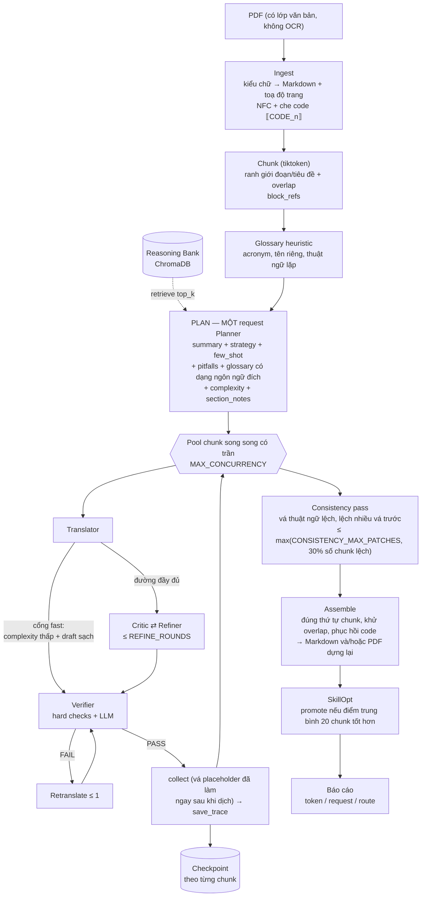

# polyglot-lc

**CLI dịch máy đa tác tử, ngữ cảnh dài** — dựng trên một đồ thị điều phối LLM
(LangGraph), một **Reasoning Bank** bền vững (ChromaDB) và **SkillOpt** (tối ưu
prompt dịch bằng "textual gradient").

Đầu vào là **PDF có lớp văn bản** (không OCR). Đầu ra chọn được: **Markdown** như
trước, **PDF dựng lại giữ nguyên định dạng** (bố cục, ảnh, đồ hoạ và lưới bảng của
trang gốc được giữ; chữ đã dịch — kể cả chữ trong ô bảng — được thay tại chỗ),
hoặc **cả hai**.

Mỗi giai đoạn đều có một chủ sở hữu rõ ràng: prompt nào nằm cùng file với bộ
parse của nó, nhờ vậy sửa một prompt không thể âm thầm làm lệch một parser ở
file khác.

---

## 1. Kiến trúc



Sơ đồ dạng text cho terminal:

```
 PDF ──Ingest──▶ NFC + che code + toạ độ ──▶ Chunk (tiktoken, overlap)
                                   │
                                   ▼
   Reasoning Bank ◀──retrieve──  PLAN: MỘT request Planner duy nhất
                                   │  summary + strategy + few_shot + pitfalls
                                   │  + glossary (kèm dạng ngôn ngữ đích)
                                   │  + complexity + ghi chú từng phần
                                   ▼
   ┌──────── pool chunk song song (MAX_CONCURRENCY) ────────────────┐
   │  Translator ─┬─ fast ──────────────────────────────────────────┼─▶ Verifier
   │              └─ full ─▶ Critic ─▶ [Refiner ─▶ Critic] × rounds │
   │  Verifier ──FAIL──▶ Retranslate (≤1) ──▶ Verifier             │
   │  Translator: dịch ─▶ vá placeholder ─▶ hard checks ─▶ route     │
   │  PASS ─▶ collect ─▶ save_trace ─▶ checkpoint                   │
   └───────────────────────────┬───────────────────────────────────┘
                               ▼
        Consistency pass (vá thuật ngữ, lệch nhiều vá trước, ngân sách theo tỉ lệ)
                               ▼
        Assemble + phục hồi code ─▶ SkillOpt ─▶ báo cáo
          (skills/<src>-<tgt>/skill.md)
```

### Workflow dự án

| # | Giai đoạn | Chủ sở hữu | Gọi model? | Kết quả |
|---|---|---|---|---|
| 1 | `ingest` | `ingest/` | không | `Document` (block + `code_map` + toạ độ trang) |
| 2 | `detect_lang` | `pipeline/coordinator` | không | mã ngôn ngữ nguồn (`langdetect`) |
| 3 | `segment` | `segment/chunker` | không | `Chunk[]` + `block_refs` |
| 4 | `glossary` | `segment/glossary` | không | thuật ngữ heuristic + CSV người dùng |
| 5 | `plan` | `analysis/unified_planner` | **1 request** | `DocumentPlan` |
| 6 | `analyse_chunks` | `analysis/complexity` | không | điểm phức tạp mỗi chunk |
| 7 | mỗi chunk | `orchestrator/graph` | 1–5 request | bản dịch + `path` |
| 8 | `consistency` | `pipeline/consistency` | ≤ trần (sàn `CONSISTENCY_MAX_PATCHES`, và ≥30% số chunk lệch) | bản vá thuật ngữ |
| 9 | `assemble_output` | `pipeline/assembler`, `pipeline/pdf_output` | không | tài liệu cuối (Markdown và/hoặc PDF) |
| 10 | `skillopt_update` | `skillopt/` | 1 request | kỹ năng (có thể) được promote |

Không có bước nào trong pipeline phụ thuộc vào việc một bước "best-effort" phải
thành công: Reasoning Bank, SkillOpt, kiểm tra tính nhất quán và việc dựng lại
PDF đều suy giảm êm thay vì làm sập cả lượt chạy — một lần dựng PDF lỗi vẫn để
lại bản Markdown đã dịch xong.

---

## 2. Tính năng

- **Bố cục tác tử lai**: 5 vai trò LLM có cấu hình riêng (Planner / Translator /
  Critic / Refiner / Verifier) cộng **Consistency editor** dùng chung cấu hình
  `REFINER` nên không cần thêm biến môi trường. Translator, Critic và Refiner
  hợp thành **nhóm đọc-nguồn** và chia sẻ một provider/model (`SOURCE_GROUP_*`),
  vì cả ba đều đọc lại đúng chunk nguồn đó. Planner và Verifier độc lập, giữ
  riêng `PLANNER_*` / `VERIFIER_*`. Bất kỳ giá trị `<NAME>_*` nào cũng ghi đè
  nhóm — trộn OpenAI, DeepSeek, proxy tương thích Anthropic, Ollama, vLLM… tuỳ ý.
- **Prompt caching gốc của provider**: nhóm đọc-nguồn gửi một tiền tố ổn định
  giống hệt nhau (văn bản gốc + glossary + strategy) lên **đầu tiên**, phần động
  đặt sau, để provider cache được khối dùng chung. Số liệu cache từ OpenAI
  (`prompt_tokens_details.cached_tokens`), DeepSeek (`prompt_cache_hit_tokens`)
  và dạng Anthropic (`cache_read_input_tokens`) được báo cáo riêng.
  `PROMPT_CACHE=explicit` mới phát thêm breakpoint `cache_control`.
- **Chỉ PDF, một bộ trích xuất duy nhất**: `ingest/pdf_layout.py` đọc trực tiếp
  kiểu chữ của PDF (run đơn cách là code, run quá cỡ là tiêu đề, khoảng hở glyph
  là chỗ ngắt từ) rồi phát ra Markdown có cấu trúc thật. `markitdown` và tầng dự
  phòng `pypdf → pdfplumber` đã bị bỏ: đầu vào là PDF có lớp văn bản, không OCR.
  Mỗi block còn mang **toạ độ trang** nơi nó được đọc ra, nên cùng một bản dịch có
  thể được dựng lại thành PDF đúng bố cục mà không phải trích xuất lần hai.
  Tên chương và số trang in ở lề bị bỏ bằng **số trang mà chính tài liệu in ra**
  (đọc độ lệch giữa số in và chỉ số trang của PDF), nên chỉ dòng nào mang đúng số
  trang của trang đó mới là trang trí: số thứ tự đầu dòng ("1. The administrator
  …"), số đầu dòng của bảng và số trang cuối mục lục vẫn ở lại làm nội dung.
  Dòng nào được tài liệu in lại ở cùng dải lề trên một phần năm số trang cũng bị
  bỏ — kể cả tiêu đề không mang số ("Guideline for Disinfection … (2008)") và
  chân trang chỉ đổi số của nó — nên phần chữ gửi cho mô hình dịch không còn
  hàng trăm bản sao của cùng một dòng.
- **Ba kiểu đầu ra**: `md` (mặc định, như trước), `pdf` — dựng lại trang gốc với
  chữ đã dịch, giữ nguyên khổ trang, ảnh, đồ hoạ vector và đường kẻ bảng — và
  `both`. Bản dịch được in **đúng kiểu chữ của trang nguồn**: cùng họ font, cùng
  độ đậm/nghiêng và cùng màu, dò từ danh sách font đã cài trên máy và chỉ nhận
  font có dấu tiếng Việt (không khớp thì lấy một font cùng loại serif/sans/mono,
  cuối cùng mới tới font mặc định). Cỡ chữ cũng giữ nguyên tuyệt đối: một dòng
  nguồn ngắn được nới ra hết bề ngang cột nếu chỗ đó còn trống, và khối nào bản
  dịch dài hơn khung thì phần dư nối tiếp ở **đầu trang sau**, cùng cỡ chữ, đẩy
  chữ của trang đó xuống dưới — không bao giờ bị thu nhỏ, và không bao giờ để lại
  một trang chỉ còn một dòng lạc; trang nối riêng chỉ còn dùng khi không còn trang
  nào để nối tiếp, hoặc trang sau bị bảng/ảnh chiếm kín. Dấu đầu dòng của danh sách và dãy chấm dẫn của mục lục
  (kèm số trang canh phải) được **vẽ lại**, vì đó là bố cục chứ không phải chữ.
  Chọn bằng `--format` trên CLI, một lựa chọn ba chiều trong web UI, hay
  `OUTPUT_FORMAT` trong `.env`. Chữ trong **ô bảng** được dịch và in lại vào đúng
  ô của lưới gốc, giữ nguyên đường kẻ, cỡ chữ, canh lề và độ đậm của ô đó; cỡ chữ
  trong ô chỉ được thu nhỏ tới 70% cỡ gốc, và ô nào bản dịch vẫn không vừa thì giữ
  nguyên tiếng gốc của chính ô đó — không tràn sang ô bên cạnh. Code vẫn là loại
  duy nhất **không được dịch** trong PDF.
- **Chia đoạn theo ngữ cảnh dài**: chunk theo token (tiktoken, ngân sách lấy từ
  `TRANSLATOR_MODEL`) tại ranh giới đoạn/tiêu đề, có overlap và `block_refs` để
  hợp nhất khử trùng. Overlap là **ngữ cảnh**, không phải nội dung: một block
  lớn hơn cả cửa sổ overlap không được replay, và phần đuôi replay bị bỏ nếu nó
  không còn chỗ bên cạnh block kế (trước đây 15/77 chunk của một sách 187 trang
  vượt ngân sách, 13 trong đó vì đuôi này; chunk lớn nhất 1 588 token so với
  ngân sách 700). Chunk chỉ bị coi là trùng khi **mọi** block của nó đã có trong
  chunk trước — hai đoạn cùng chữ nhưng khác block đều được giữ.
- **Plan tài liệu trong một lần gọi**: toàn bộ giai đoạn planner — tóm tắt tài
  liệu, strategy, few-shot, pitfalls, thuật ngữ *kèm dạng ngôn ngữ đích*, độ
  phức tạp và ghi chú từng phần — là **một** request. Planner thấy **toàn bộ**
  tiêu đề mục; phần thân được lấy thành 6 mảnh rải đều khắp tài liệu (tổng 3.000
  ký tự, `[...]` đánh dấu chỗ bị bỏ) thay vì chỉ đọc những trang đầu — với sách
  1000 trang thì 3.000 ký tự đầu chỉ là bìa và mục lục. Danh sách mục có trần
  20.000 ký tự: preview tự co lại khi mục quá nhiều, hết chỗ thì chỉ còn tên, và
  nếu tên cũng không vừa thì dòng `(+N more sections not shown)` nói rõ đã bỏ bao
  nhiêu mục. Nhờ vậy prompt planner của tài liệu 1000 trang dày tiêu đề giảm từ
  37.700 xuống 7.099 token. Nhánh summary-tree cũ (một request mỗi mục, rồi
  thêm một request plan, không trả về cặp thuật ngữ) đã bị xoá hẳn; đo trên tài
  liệu 20 chunk (LLM_MOCK) nó tốn 22 request Planner và 82 request tổng, so với
  **1** và **61** của đường hợp nhất — tức 21 request Planner và ~26% tổng
  request được cắt bỏ trước khi chunk đầu tiên được dịch.
- **Pipeline chất lượng thích ứng**: mỗi chunk được chấm cục bộ (cấu trúc, độ
  dài, placeholder, mật độ thuật ngữ) và draft được kiểm bằng đúng những cổng
  tất định mà Verifier dùng. Chunk đơn giản có draft sạch đi **thẳng tới
  Verifier**, bỏ qua Critic và Refiner; chunk đáng ngờ chạy vòng
  Critic → Refiner đầy đủ.  `FAST_PATH_SKIP_LLM_VERIFY=1` bỏ luôn lần gọi
  Verifier trả phí khi các kiểm tra cứng đã qua. Định tuyến tốn **0 token**.
- **Verifier lỗi không được ghi thành "đã đạt"**: khi Verifier không chạy được,
  kết quả vẫn mang `ok` để không chặn bản dịch nhưng có thêm cờ `skipped`;
  decision ghi "no verdict, the draft ships unverified", mỗi chunk như vậy để
  lại một bản ghi `error` (cause `verify`), và con số lên `run_end`
  (`verify_skipped`) cùng dòng cuối CLI. Trước đây cả ba nơi đều đọc như
  "verifier accepted the draft".
- **Checkpoint chống sập**: mỗi chunk xong được ghi vào
  `<CHECKPOINT_DIR>/<job>/<chunk>.json`; `--resume` bỏ qua các chunk đã xong
  (một lượt resume trọn vẹn tốn 0 request). Checkpoint gắn với đường dẫn, **nội
  dung** file (sha256 — không phải `mtime`: upload lại đúng tài liệu đó không
  được phép xoá công đã dịch), cặp ngôn ngữ, model Translator, hash
  của chunk **và nội dung glossary người dùng**, nên đổi input, đổi
  `--max-tokens` hay thêm một thuật ngữ vào CSV đều không bao giờ dùng lại kết
  quả cũ — nếu không, `--resume` sẽ phát lại đúng những chunk đã dịch khi chưa
  có thuật ngữ đó và file ra thiếu hẳn thuật ngữ mới.
  `PARTIAL_OUTPUT=1` còn ghi lại file đầu ra khi từng chunk hoàn thành.
- **Một chunk lỗi không bao giờ bị bỏ**: cạn các lần thử lại ở tầng request
  (`LLM_MAX_RETRIES`) thì **chunk** được chờ rồi chạy lại nguyên vẹn — 5s, 10s,
  20s… tới `CHUNK_RETRY_MAX_DELAY` (mặc định 120s), lặp lại **không giới hạn**
  cho tới khi chunk có bản dịch. Lối ra duy nhất là Ctrl-C (CLI) hoặc nút Dừng
  (web UI); trong lúc chờ, lượt chạy in ra, ghi sự kiện `retry_wait` vào log và
  caption dưới thanh tiến độ nói đang chờ chunk nào, hỏng ở bước nào, chờ bao
  lâu — một lượt chờ vài phút không được trông như treo.
  **Trừ khi không còn gì để thử**: agent đã cạn lượt thử lại mà không có endpoint
  dự phòng, hoặc lỗi mà không lần retry nào chữa được (401/400) — lúc đó chunk
  được hỏi **một lần** rồi lượt chạy dừng, báo lý do, thay vì quay vòng mãi.
  **Và trừ khi provider trả lời rỗng**: một reply rỗng (từ chối, content filter,
  model trả về toàn khoảng trắng) không phải sự cố chờ được — hỏi lại 2 lần,
  rồi tách đôi chunk, rồi để chunk ở dạng `<!-- chunk-NNN: untranslated -->`
  trong file và **không** ghi checkpoint, thay vì giữ cả lượt chạy đứng ở thanh
  tiến độ (trước đây vòng chờ rỗng không có trần).
  Bản dịch đã sinh ra **được giữ lại**: hỏng ở Critic/Verifier thì lần chạy sau
  vào thẳng bước đó, không gọi lại Translator cho cùng một câu (đây cũng là chỗ
  từng đốt ~14 phút mỗi lần bấm Tiếp tục). Vì vậy file kết quả của một lượt đã
  xong không còn dấu `<!-- chunk-NNN: untranslated (source blocks 4-6 lost) -->`;
  marker đó chỉ còn là lưới an toàn cho file viết dở (`PARTIAL_OUTPUT=1`) và cho
  người gọi thẳng `assemble()`. Trạng thái cuối của lượt nói về **file**: mọi
  chunk đã dịch thì `run_end` là `done` (mã thoát 0), còn những lần phải chờ vẫn
  nằm trong log và `problems` — `failed` chỉ dành cho lượt không giao được bản
  dịch trọn vẹn (còn chunk trống, hoặc lượt chết vì lỗi khác `LLMError`).
- **Nhất quán xuyên chunk**: sau khi dịch, glossary đã lên kế hoạch được áp lên
  toàn tài liệu. Chunk đi lệch được **vá** (giới hạn bởi `CONSISTENCY_MAX_PATCHES`,
  mặc định 5) thay vì dịch lại, và bản vá chỉ được giữ nếu nó thật sự đưa đúng
  thuật ngữ đã định vào **và** vượt qua đúng các hard check của một bản dịch:
  marker `⟦CODE_n⟧` bị rơi được chèn lại, cấu trúc heading phải giữ nguyên —
  lúc lắp ráp code chỉ được phục hồi bằng `str.replace`, nên một bản vá làm rơi
  marker là xoá hẳn khối code mà không để lại dấu vết. Một "lệch đồng loạt" (không chunk nào dùng thuật ngữ dự
  kiến) được báo cáo chứ không vá, vì không có gì để các chunk thống nhất *theo*.
  Ngân sách vá là `max(CONSISTENCY_MAX_PATCHES, 30% số chunk lệch)`, và mỗi bản
  vá là **một request** gửi cả bản dịch của chunk kèm glossary rồi nhận lại cả
  bản dịch — nên trần đó lên `run_end` (`consistency_patch_budget`) và dòng CLI
  (`consistency patch budget: N request(s), M used`) thay vì chỉ nằm trong log.
  Hai bản vá liền bị từ chối (editor rơi thuật ngữ, mất bản dịch, hoặc phá cấu
  trúc) là dấu hiệu model đang phớt lờ chỉ dẫn: pass **dừng** thay vì đốt hết
  ngân sách vào cùng một câu trả lời, và số chunk còn lệch vẫn được đếm là bỏ
  sót (`consistency_skipped`), cùng cờ `stopped_early` trong báo cáo của pass.
  Pass còn so cả **nhãn** (`Preconditions:`, `Bước 3`, `Hình 2.1`) và **cụm lặp
  lại** ở đầu đoạn — những thứ không có trong glossary. Không có dạng đích nào
  được biết trước, nên chính tài liệu bầu: dạng mà **đa số** chunk dùng thành
  chuẩn, chunk lệch bị vá; hoà 1–1 thì không kết luận gì. Vị trí là căn chỉnh duy
  nhất — đoạn thứ i của bản dịch ứng với đoạn thứ i của nguồn, chunk nào lệch số
  đoạn thì bỏ qua. Số nhãn đã so và số nhãn lệch lên `run_end`
  (`consistency_labels`, `consistency_label_drift`) và dòng cuối của CLI. Cùng
  với đó là `consistency_checked_terms` (số thuật ngữ **thật sự** được so) và
  `consistency_no_pairs`: "0 lệch" trên 0 thuật ngữ không đọc giống "0 lệch"
  trên 175 — khi không có cặp nào để so (planner fallback, không có CSV), CLI
  nói thẳng là chỉ so nhãn. `glossary_terms` cũng đếm số mục thật trong khối
  glossary gửi cho prompt, thay vì chỉ đếm cặp của Planner.
- **Sửa placeholder tất định**: code không bao giờ tới model — nó được che thành
  `⟦CODE_n⟧` và hoàn trả nguyên văn khi hợp nhất. Vì `restore_code` chỉ là
  `str.replace`, một marker bị model làm rơi sẽ **âm thầm** xoá cả khối code;
  `pipeline/placeholders.py` chèn lại marker vào đúng vị trí đoạn của nó trước
  khi chunk được checkpoint.
- **Glossary**: acronym, cụm viết hoa, thuật ngữ lặp ≥ 2 lần, cộng CSV người
  dùng. Planner bổ sung dạng ngôn ngữ đích; CSV của người dùng luôn thắng. Ngân
  sách thuật ngữ lớn dần theo tài liệu — `40 + ký_tự/8000`, kẹp trong `[40, 200]`
  ([glossary.py](src/polyglot_lc/segment/glossary.py)) — nên sách 1000 trang được
  ~175 mục thay vì dừng ở 40, còn bản ghi nhớ vẫn giữ nguyên 40. Trần 200 bằng
  trần CSV, và mục do người dùng nhập **không bao giờ** bị ngân sách cắt.
- **Reasoning Bank** (ChromaDB): trace bền vững `{strategy, few_shot, pitfalls,
  score, ts…}`, chỉ upsert khi score ≥ 0.75. Tự reset collection khi số chiều
  embedding đổi (đổi `EMBED_MODEL`, vào/ra mock).
- **SkillOpt**: thu thập (prompt, output, điểm) theo từng chunk; Planner đề xuất
  textual gradient; kỹ năng chỉ được promote khi điểm trung bình 20 chunk gần
  nhất **thắng** kỹ năng đang dùng. Skill được lưu thành
  `skills/<src>-<tgt>/skill.md` và được đọc lại vào prompt Translator ở lượt
  kế tiếp.
- **Hàng đợi theo từng provider**: tối đa  `LLM_PROVIDER_CONCURRENCY` (mặc định
  **1**) request đang bay cho mỗi `base_url`, để gói miễn phí chỉ phục vụ một
  request không bị pool chunk giẫm lên. Đây là **hàng đợi**, không phải van: các
  lời gọi xếp hàng chờ lượt thay vì thất bại, thời gian xếp hàng không bị tính
  vào deadline của chính request đó, và slot được trả lại kể cả khi request lỗi.
  Free tier để 1 (an toàn mặc định); provider trả tiền / self-host nâng lên đúng
  giới hạn thật của provider. Pool worker (`MAX_CONCURRENCY`) giữ nguyên độc lập
  với queue, không bị ép theo.
- **Timeout theo yêu cầu có trần**: mọi lời gọi LLM/embedding bị chặn bởi
  `LLM_TIMEOUT` (mặc định 45s), ghi đè theo từng agent bằng `<NAME>_TIMEOUT`
  (ví dụ `VERIFIER_TIMEOUT`) hoặc `EMBED_TIMEOUT`. SDK `timeout` là *read*
  timeout (mỗi byte tới lại reset nó), nên còn một **deadline wall-clock thật**
  ở trên nó: một endpoint treo sẽ thành lỗi timeout có thể retry trong vòng vài
  chục giây thay vì treo tiến trình hàng chục phút. Verifier suy giảm êm.
- **Retry có kiểm soát**: lỗi hạ tầng (429/408/timeout/5xx/lỗi kết nối) retry
  theo backoff lũy thừa + jitter giới hạn (`LLM_RETRY_JITTER`) và tôn trọng
  `Retry-After`. Một 429 kiểu "vẫn còn request đang chạy" được thử lại sau **ít
  nhất** `LLM_RETRY_CONCURRENCY_WAIT` (mặc định 10s), vì backoff 2s chỉ đâm vào
  chính request đang chạy phía server; jitter được **cộng lên trên** sàn đó chứ
  không trừ xuống. Lỗi ngữ nghĩa (Verifier FAIL) dùng một nhánh retranslate
  riêng, có giới hạn.
- **Endpoint dự phòng cho mọi agent, trừ embedding**: khi endpoint chính đã
  cạn lượt thử lại, lời gọi chuyển sang endpoint dự phòng (Planner, Translator,
  Critic, Refiner, Verifier). Một endpoint dự phòng cho cả pipeline, đặt bằng
  `LLM_BACKUP_BASE_URL` + `LLM_BACKUP_MODEL` (+ `LLM_BACKUP_API_KEY`). Embedding
  không có dự phòng: Reasoning Bank là phần best-effort.
- **Không có dự phòng thì lượt chạy dừng, không quay vòng vô hạn**: khi agent đã
  hết lượt thử lại mà không có nơi để chuyển sang, chunk đó được hỏi **một lần**
  rồi lượt chạy kết thúc với lý do rõ ràng (mã thoát 1, ghi trong log và ở bảng
  Errors của web UI) — thay vì ngồi ở "0/38" chờ một endpoint đã từ chối trả
  lời. Có dự phòng thì vòng lặp cấp chunk vẫn chạy: mỗi vòng thử lại chính rồi
  dự phòng.
- **Cổng thích ứng cho Refiner**: `REFINE_MIN_SCORE` bỏ qua Refiner với draft đã
  đủ điểm (mặc định bằng `CRITIC_THRESHOLD`, nên hành vi không đổi trừ khi nâng
  lên).
- **Quan sát cache**: mỗi request được gắn `HIT` / `MISS` / `UNKNOWN` **chỉ** từ
  metadata của provider (thiếu metadata không bao giờ bị tính là miss), kèm tổng
  token input đã cache / chưa cache và một fingerprint debug của tiền tố ổn định.
- **CLI đơn giản, không động**: mỗi bước một dòng (`[3] Running critic
  (chunk-000) ...`), rồi một báo cáo token/request gọn (input, cached input,
  uncached input, output, tổng, request — kèm bảng theo provider/model). Không
  spinner, không progress bar, không dashboard vẽ lại. Sự kiện có cấu trúc vẫn
  được ghi ra `logs/run_<ts>.jsonl`.
- **Song song có trần**: các chunk độc lập chạy song song tối đa
  `MAX_CONCURRENCY` (mặc định 2), mỗi chunk giữ nguyên thứ tự nội bộ
  Translate → [Critic → Refiner] → Verify. Output luôn được hợp nhất theo thứ tự
  chunk gốc bất kể thứ tự hoàn thành.
- **Cổng chất lượng**: kiểm tra cứng tất định (placeholder `⟦CODE_n⟧`, cấp tiêu
  đề) + phán quyết LLM; Verifier fail kéo theo một lần dịch lại có kèm lý do.
  Lỗi cấu trúc chặn **trước** lời gọi Verifier trả phí.

---

## 3. Cài đặt

Yêu cầu Python 3.11+.

```bash
python -m venv .venv
# Linux/macOS:  source .venv/bin/activate
# Windows:      .venv\Scripts\Activate.ps1

pip install -e ".[dev]"        # hoặc: uv pip install -e ".[dev]"
```

## 4. Cấu hình

Sao chép `.env.example` → `.env` và điền cấu hình theo từng tác tử:

```dotenv
PLANNER_BASE_URL=https://api.openai.com/v1
PLANNER_MODEL=gpt-4o-mini
PLANNER_API_KEY=sk-...
PLANNER_TEMPERATURE=0.2

# Nhóm đọc-nguồn: Translator + Critic + Refiner dùng chung một provider.
SOURCE_GROUP_BASE_URL=https://api.openai.com/v1
SOURCE_GROUP_MODEL=gpt-4o
SOURCE_GROUP_API_KEY=sk-...
SOURCE_GROUP_TEMPERATURE=0.3

VERIFIER_BASE_URL=https://api.openai.com/v1
VERIFIER_MODEL=gpt-4o-mini
VERIFIER_API_KEY=sk-...

EMBED_BASE_URL=https://api.openai.com/v1
EMBED_MODEL=text-embedding-3-small
EMBED_API_KEY=sk-...
```

Thiếu key bắt buộc sẽ báo lỗi rõ ràng trên **Errors panel**.

### Nhóm biến

Bốn nhóm endpoint ở trên là phần duy nhất bắt buộc. Mọi biến còn lại — đường dẫn,
chia đoạn, chất lượng, đường tắt thích ứng, nhất quán, retry/timeout, hàng đợi
theo provider, chạy lại chunk, cache, logging, ghi đè theo từng agent và endpoint
dự phòng — có bảng đầy đủ kèm mặc định và khi nào nên đổi ở
[`docs/configuration.md`](docs/configuration.md). Ở đó cũng có công thức cho các
tình huống hay gặp (chạy thử không cần key, gói miễn phí chỉ cho một request cùng
lúc, tiết kiệm token, đầu ra PDF) và cách rút gọn một `.env` đang có.

### Chế độ demo / offline không cần key

Đặt `LLM_MOCK=1` để chạy toàn bộ pipeline với mock tất định trong tiến trình
(không key, không mạng). Embedding tự lùi về vector hash tất định khi endpoint
không tới được.

## 5. Sử dụng

```bash
polyglot translate --file input/handbook.pdf --src en --tgt vi
# Dựng lại PDF đúng bố cục, và ghi thêm bản Markdown cạnh nó:
polyglot translate --file report.pdf --src auto --tgt en \
    --glossary glossary.csv --out report.en.md --format both --max-tokens 512
```

| Tuỳ chọn | Mô tả |
|---|---|
| `--file / -f` | **File PDF đầu vào** (phải có lớp văn bản; không OCR) |
| `--src / -s` | Ngôn ngữ nguồn, `auto` = langdetect |
| `--tgt / -t` | Mã ngôn ngữ đích |
| `--glossary / -g` | CSV glossary `src,tgt` mỗi dòng |
| `--out / -o` | Đường dẫn gốc của đầu ra: `<gốc>.md` và/hoặc `<gốc>.pdf` (mặc định `<stem>.<tgt>.md`) |
| `--format / -F` | `md` (mặc định) \| `pdf` (dựng lại PDF giữ định dạng) \| `both` (env: `OUTPUT_FORMAT`) |
| `--max-tokens / -m` | Ghi đè ngân sách token mỗi chunk |
| `--quiet / -q` | Chỉ in báo cáo cuối, không in từng bước |
| `--resume / --no-resume` | Dùng lại checkpoint của lượt chạy bị gián đoạn (env: `RESUME`) |
| `--checkpoint-dir` | Nơi lưu checkpoint theo chunk (env: `CHECKPOINT_DIR`) |
| `--run-id` | Tên của lượt chạy này (mặc định: `RUN_ID` từ môi trường, không thì tự sinh) |

Báo cáo cuối in ra: số chunk, điểm critic trung bình (đánh dấu *est.* khi không
có Critic nào chạy), số lần retry (**gồm cả retry cấp chunk**, không chỉ retry
request — con số trước đây thấp hơn thực tế), số trace đã lưu, việc promote kỹ
năng, số chunk đã đi mỗi đường **fast / standard / deep** (kèm lý do khi fast
path bị từ chối), số request Planner, số thuật ngữ glossary, số chunk resume, số
bản vá nhất quán **kèm ngân sách request của pass, số chunk còn lệch vì hết
ngân sách và số bản vá bị từ chối**, file đầu ra, file PDF (kèm số block đã
dựng lại), đường dẫn log JSONL và bảng token/request.

### Đọc lại một lượt chạy

```bash
polyglot trace                          # lượt mới nhất dưới logs/
polyglot trace 20261012_015104_dad6b2    # theo run id
polyglot trace logs/webui/<id>/run_*.jsonl --json
```

Lệnh in ra: cài đặt lượt chạy (file, `sha256`, `plan_hash`, ngôn ngữ, max token,
từng agent + host), dòng thời gian theo từng khối (đã đi đường nào **và vì sao**,
thời lượng và token từng bước), các vấn đề kèm `cause`, và tổng kết
(token/request/cache/retry, file sinh ra, thống kê dựng lại PDF). Không có đối số
thì nó quét đệ quy `logs/` — kể cả lượt do web UI chạy, vốn nằm trong thư mục
riêng của nó. Đọc một lượt đã hỏng là việc bình thường: lệnh thoát 0 và nói rõ
lượt đó không để lại bản ghi nào.

Ghi chú trace là **chỉ metadata**: id, hash, độ dài, số token, thời lượng, quyết
định + lý do, nguyên nhân lỗi. Không có văn bản tài liệu và không có bản dịch,
không có giá trị biến môi trường, và `run_start` ghi **host** của provider chứ
không ghi URL đầy đủ — có test canary khoá cả hai điều đó.

Token theo từng bước là **xấp xỉ khi `MAX_CONCURRENCY > 1`**: bộ đếm token là
của toàn tiến trình, nên hai chunk chạy cùng lúc có thể tính nhầm cho nhau.

## 6. Demo không cần key

```bash
LLM_MOCK=1 polyglot translate --file eocortex-4.6-specification.pdf \
    --src en --tgt vi --format both
```

Bạn sẽ thấy mỗi bước một dòng rồi tới báo cáo:

```
  [1] Running ingest ...
  [2] Running segment ...
  ...
Completed.

Token usage:
  Input:  11,963
  Output: 248
  Total:  12,211
  Requests: 15
```

## 7. Giao diện web

```bash
python -m webui.server               # rồi mở http://127.0.0.1:8787
python -m webui.server --port 9000   # đổi cổng, vẫn chỉ bind loopback
```

Kéo thả một file PDF vào ô đầu hộp thoại, chọn ngôn ngữ ở hai đầu, rồi bấm
**Bắt đầu dịch**. Danh sách ngôn ngữ viết đủ tên chứ không viết tắt (`vi` là
"Tiếng Việt"); nguồn có thêm **Tự động nhận diện**, đích có **Tiếng Anh** như
mọi ngôn ngữ khác. Trang hiện thanh tiến độ theo
khối cùng dải giai đoạn của pipeline, và khi xong thì mở hai khung cạnh nhau:
bản gốc đã trích xuất (đúng văn bản mà bộ dịch đã đọc) và bản dịch. Lịch sử nằm ở
cột trái, đọc từ `logs/webui/<run_id>/run.json` — sống sót qua lần khởi động lại
server — kèm bộ lọc theo trạng thái.

Nhóm **Kết quả xuất ra** là một lựa chọn ba chiều, đúng bằng `--format`: **Chỉ
Markdown** (mặc định), **Chỉ PDF giữ nguyên định dạng**, hoặc **Markdown và PDF**.
Một lựa chọn thay vì hai ô tick, vì hai ô tick cho phép một trạng thái thứ tư
(không chọn gì) mà server chỉ có thể trả lời bằng lỗi. Khi lượt chạy xong, liên kết
**Mở PDF** xuất hiện cạnh liên kết **Mở Markdown**; lượt chạy chỉ xuất PDF vẫn mở
được vì đường dẫn PDF được suy ra từ đường dẫn Markdown, và **Tải tất cả (.zip)**
gói cả hai khi lượt chạy viết ra cả hai.

**Trang này không có bề mặt cấu hình nào.** Không màn hình cài đặt, không trạng
thái API key, không công tắc chạy thử. Lượt chạy thừa hưởng môi trường của tiến
trình server, còn những gì trang gửi chỉ là tài liệu, hai ngôn ngữ và định dạng
kết quả. Lĩnh vực, glossary và ngân sách token không có ô nhập nào: lượt chạy
mặc định `general`, từ điển thuật ngữ do pipeline tự luận ra từ chính văn bản, và
ngân sách token lấy từ `.env` (`CHUNK_MAX_TOKENS`).
Muốn đổi thiết lập thì sửa `.env` rồi chạy lại server; `python webui/probe.py
--config` cho biết cấu hình hiệu lực cùng nguồn của từng giá trị (`env` /
`dotenv` / `default`).

- Server chỉ bind `127.0.0.1`, và chỉ nhận `POST`/`PUT` mang `Origin` của chính nó.
- Mỗi lượt là một tiến trình `python -m polyglot_lc.cli translate` riêng, có
  `LOGS_DIR` và `--out` riêng; đóng tab hay tắt server không giết lượt đang chạy.
- Nút **Dừng** kill cả cây tiến trình và không hỏi lại — các khối đã xong nằm trong
  checkpoint, nên **Tiếp tục** ngay cạnh đó là đường quay lại, không mất việc.
- Upgrade file vào `input/` chỉ nhận PDF thật (thiếu `%PDF-` là bị từ chối trước
  khi ghi), và một tên đã tồn tại phải được xác nhận ghi đè.
- Không có màn hình nào để nhập glossary hay sửa skill: chúng chỉ được sinh ra
  và cập nhật qua chính các lượt dịch, còn bộ nhớ dịch chỉ được ghi theo cách đó.
- Test của UI nằm ở `tests/test_webui_*.py`, không cần API key và không mở cổng.

## 8. Kiểm thử

```bash
pytest -q                      # toàn bộ suite
python -m ruff check .         # lint
python -m ruff format --check .  # định dạng (ruff format . để sửa)
```

710 test, bao phủ: ingest (registry chỉ nhận PDF, che code, NFC, kiểu chữ →
Markdown, gán toạ độ trang *và kiểu chữ* cho từng block), dựng lại PDF (map chunk
→ block, cắt overlap, chọn font theo họ nguồn, **nới khung một dòng ra hết cột**,
**vẽ lại đầu dòng và chấm dẫn mục lục**, rebuild thật rồi đọc lại văn bản), ngân
sách & overlap của
chunker, glossary, validate config, LLM client trên HTTP giả lập (`respx`),
deadline wall-clock, hàng đợi theo provider, Reasoning Bank
(retrieve/gate/persistence), SkillOpt, TM, luật router, và một pipeline end-to-end
ở mock mode — cùng lớp workflow: độ phức tạp/tín hiệu draft, planner một lời gọi,
định tuyến thích ứng, checkpoint/resume (kể cả vô hiệu hoá và ghi từng phần), sửa
placeholder, và nhất quán xuyên chunk.

Trong đó 164 test thuộc `tests/test_webui_*.py`: phân giải đường dẫn an toàn, vòng
đời lượt chạy (kể cả dừng theo cây tiến trình, và ghi chú "chưa có log" được rút
lại khi log xuất hiện), HTTP API và an toàn (Origin, traversal, che credential,
nhận dạng upload), cộng một nhóm đọc **chính trang đã phát hành**: mọi id script
tìm đều có trong HTML, mọi trạng thái script ghi đều có luật CSS, và không có bề
mặt cấu hình nào trong ba asset — không test nào mở cổng, cần API key, hay chạm tới
provider. Test nào cần một tài liệu đầu vào thì **tự dựng một PDF thật**
(`tests/pdfdoc.py`), vì đầu vào bây giờ chỉ có PDF.

## 9. Cấu trúc dự án

```
src/polyglot_lc/
├── cli.py                 # CLI typer + báo cáo token/request
├── config.py              # config per-agent + nhóm đọc-nguồn, chính sách cache, knobs workflow
├── analysis/              # unified_planner (plan 1 lời gọi), complexity + tín hiệu draft
├── pipeline/              # coordinator, assembler, pdf_output (dựng lại PDF), checkpoint,
│                          #   consistency, placeholders
├── ingest/                # registry (chỉ PDF), pdf, pdf_layout (kiểu chữ → Markdown + toạ độ)
├── segment/               # chunker, summary_tree (chia mục + preview), glossary
├── agents/                # base, context, planner, translator, critic, refiner, verifier, consistency
├── orchestrator/          # LangGraph state, router, graph (cạnh thích ứng)
├── reasoning_bank/        # store ChromaDB, embedder, schema trace
├── skillopt/              # optimizer, skill_store
├── memory/tm.py           # translation memory
├── llm/client.py          # client OpenAI-compatible (+ cache metrics, hàng đợi, deadline, mock)
└── ui/                    # SimpleUI (báo cáo bước) + EventSink (JSONL)

webui/                     # ứng dụng UI web (chạy polyglot_lc như tiến trình con)
├── server.py              # HTTP server: routing, static, API
├── runs.py                # RunManager: spawn / trạng thái / stop / sự kiện
├── store.py               # run.json, skills, glossaries (không chạm .env)
├── probe.py               # tiến trình con: --plan, --text, --memory
└── static/                # index.html, app.css, app.js (không webfont, không CDN)
```

`polyglot_lc.pipeline` là một package (`coordinator`, `assembler`, `checkpoint`,
`consistency`, `placeholders`) nhưng giữ nguyên tên công khai, nên
`from polyglot_lc.pipeline import TranslationPipeline` không đổi.

---

## 10. Ghi chú và giới hạn

- **Số đo ở mục 1 và 2 được lấy ở `LLM_MOCK=1`** (bộ đếm request của chính
  pipeline, tất định). Chưa đo với provider thật: chất lượng bản dịch và tỉ lệ
  cache hit thật phụ thuộc nhà cung cấp.
- `LLM_PROVIDER_CONCURRENCY=1` là lựa chọn thận trọng: nó tuần tự hoá các request
  trong cùng một `base_url`, nên provider trả phí sẽ chậm hơn cho tới khi bạn
  nâng lên đúng giới hạn thật. Chưa có cơ chế tự nới/thu.
- Verifier **không** nhận glossary: nó xác minh độ đầy đủ, không thêm bớt, ngôn
  ngữ và cấu trúc, chứ không xác minh thuật ngữ (việc đó thuộc Consistency pass).
- Verifier chụp 2000 ký tự đầu của nguồn và của bản dịch; chunk dài hơn sẽ được
  xác minh trên phần đầu đó.
- **PDF dựng lại ở mức block, không phải mức content-stream.** Bản dịch được in
  vào đúng khung của block nguồn (PyMuPDF: redaction rồi chèn chữ, nhúng font
  Unicode), chứ không viết lại từng glyph trong content stream như PDFMathTranslate/
  pdf2zh. Văn xuôi một cột gần như trùng khít; cột báo và công thức có thể lệch
  khung — vì vậy **bảng được dựng lại theo từng ô trong đúng lưới của trang gốc**
  thay vì dàn lại cột, ô nào không đủ chỗ thì in lại chữ nguồn của ô đó, và block
  không có bản dịch (chunk hết lượt thử lại) giữ nguyên chữ nguồn.
- **Một block chỉ có một kiểu chữ.** Dòng nguồn trộn kiểu (ví dụ “**Eocortex ST**
  được thiết kế…”) được in bằng kiểu chiếm phần lớn ký tự; phần đậm lẻ trong một
  câu không được tái tạo.
- **Chép chữ ra khỏi PDF dựng lại có thể gặp U+00A0 thay cho dấu cách và U+00AD
  thay cho gạch nối** — đó là cách PyMuPDF mã hoá glyph của font nhúng, không
  phải lỗi bản dịch; trên trang in ra thì không thấy khác biệt. `polyglot trace`
  và đầu ra Markdown không bị ảnh hưởng.
- **PDF quét ảnh không được hỗ trợ** (không OCR): một trang không có lớp văn bản
  làm bộ trích xuất báo lỗi rõ ràng chứ không tạo ra tài liệu rỗng.
- PDF đầu ra cần một font `.ttf` có dấu tiếng Việt. Chương trình tự dò Times/Arial/
  Segoe UI/DejaVu… và báo lỗi rõ khi không thấy; đặt `PDF_FONT_PATH` để chỉ định.
- `.env.example` để mọi biến tinh chỉnh ở dạng **comment kèm mặc định**, nên
  sao chép bản mẫu không đóng băng mặc định của mã. Hai biến trước đây thiếu ở
  bản mẫu — `LLM_PROVIDER_CONCURRENCY` và `LLM_RETRY_CONCURRENCY_WAIT` — nay đã
  có mặt ở đó.
