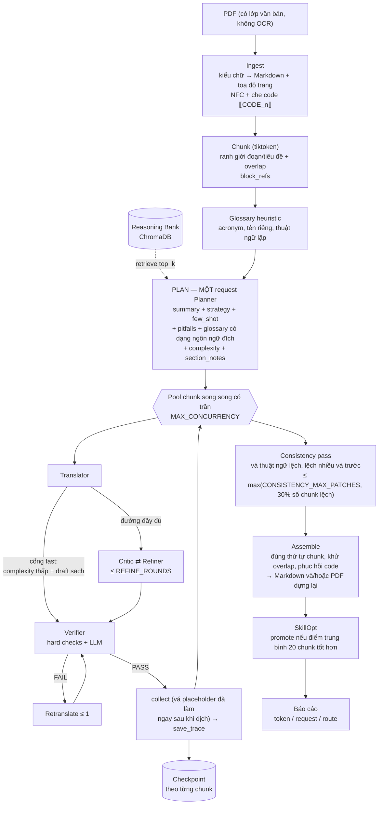

# Kiến trúc và cơ chế chi tiết

Tài liệu này là phần đặc tả đầy đủ của pipeline: sơ đồ, hợp đồng giữa các giai đoạn và lý do đằng sau từng cơ chế. `README.md` chỉ giữ những gì cần để cài đặt và chạy.

## Kiến trúc



Sơ đồ dạng text cho terminal:

```
 PDF ──Ingest──▶ NFC + che code + toạ độ ──▶ Chunk (tiktoken, overlap)
                                   │
                                   ▼
   Reasoning Bank ◀──retrieve──  PLAN: MỘT request Planner duy nhất
                                   │  summary + strategy + few_shot + pitfalls
                                   │  + glossary (kèm dạng ngôn ngữ đích)
                                   │  + complexity + ghi chú từng phần
                                   ▼
   ┌──────── pool chunk song song (MAX_CONCURRENCY) ────────────────┐
   │  Translator ─┬─ fast ──────────────────────────────────────────┼─▶ Verifier
   │              └─ full ─▶ Critic ─▶ [Refiner ─▶ Critic] × rounds │
   │  Verifier ──FAIL──▶ Retranslate (≤1) ──▶ Verifier             │
   │  Translator: dịch ─▶ vá placeholder ─▶ hard checks ─▶ route     │
   │  PASS ─▶ collect ─▶ save_trace ─▶ checkpoint                   │
   └───────────────────────────┬───────────────────────────────────┘
                               ▼
        Consistency pass (vá thuật ngữ, lệch nhiều vá trước, ngân sách theo tỉ lệ)
                               ▼
        Assemble + phục hồi code ─▶ SkillOpt ─▶ báo cáo
          (skills/skill.md)
```

### Workflow dự án

| # | Giai đoạn | Chủ sở hữu | Gọi model? | Kết quả |
|---|---|---|---|---|
| 1 | `ingest` | `ingest/` | không | `Document` (block + `code_map` + toạ độ trang) |
| 2 | `detect_lang` | `pipeline/coordinator` | không | mã ngôn ngữ nguồn (`langdetect`) |
| 3 | `segment` | `segment/chunker` | không | `Chunk[]` + `block_refs` |
| 4 | `glossary` | `segment/glossary` | không | thuật ngữ heuristic + thuật ngữ lõi của cặp ngôn ngữ |
| 5 | `plan` | `analysis/unified_planner` | **1 request** | `DocumentPlan` |
| 6 | `analyse_chunks` | `analysis/complexity` | không | điểm phức tạp mỗi chunk |
| 7 | mỗi chunk | `orchestrator/graph` | 1–5 request | bản dịch + `path` |
| 8 | `consistency` | `pipeline/consistency` | ≤ ngân sách lượt vá × (1 editor + 1 verifier) | bản vá thuật ngữ đã kiểm định |
| 9 | `assemble_output` | `pipeline/assembler`, `pipeline/pdf_output` | không | tài liệu cuối (Markdown và/hoặc PDF) |
| 10 | `skillopt_update` | `skillopt/` | 1 request | kỹ năng (có thể) được promote |

Không có bước nào trong pipeline phụ thuộc vào việc một bước "best-effort" phải
thành công: Reasoning Bank, SkillOpt, kiểm tra tính nhất quán và việc dựng lại
PDF đều suy giảm êm thay vì làm sập cả lượt chạy — một lần dựng PDF lỗi vẫn để
lại bản Markdown đã dịch xong.

---

## Cơ chế và tính năng

- **Bố cục tác tử lai**: 5 vai trò LLM có cấu hình riêng (Planner / Translator /
  Critic / Refiner / Verifier) cộng **Consistency editor** dùng chung cấu hình
  `REFINER` nên không cần thêm biến môi trường. Translator, Critic và Refiner
  hợp thành **nhóm đọc-nguồn** và chia sẻ một provider/model (`SOURCE_GROUP_*`),
  vì cả ba đều đọc lại đúng chunk nguồn đó. Planner và Verifier độc lập, giữ
  riêng `PLANNER_*` / `VERIFIER_*`. Bất kỳ giá trị `<NAME>_*` nào cũng ghi đè
  nhóm — trộn OpenAI, DeepSeek, proxy tương thích Anthropic, Ollama, vLLM… tuỳ ý.
- **Prompt caching gốc của provider**: nhóm đọc-nguồn gửi một tiền tố ổn định
  giống hệt nhau (văn bản gốc + glossary + strategy) lên **đầu tiên**, phần động
  đặt sau, để provider cache được khối dùng chung. Số liệu cache từ OpenAI
  (`prompt_tokens_details.cached_tokens`), DeepSeek (`prompt_cache_hit_tokens`)
  và dạng Anthropic (`cache_read_input_tokens`) được báo cáo riêng.
  `PROMPT_CACHE=explicit` mới phát thêm breakpoint `cache_control`.
- **Chỉ PDF, một bộ trích xuất duy nhất**: `ingest/pdf_layout.py` đọc trực tiếp
  kiểu chữ của PDF (run đơn cách là code, run quá cỡ là tiêu đề, khoảng hở glyph
  là chỗ ngắt từ) rồi phát ra Markdown có cấu trúc thật. `markitdown` và tầng dự
  phòng `pypdf → pdfplumber` đã bị bỏ: đầu vào là PDF có lớp văn bản, không OCR.
  Mỗi block còn mang **toạ độ trang** nơi nó được đọc ra, nên cùng một bản dịch có
  thể được dựng lại thành PDF đúng bố cục mà không phải trích xuất lần hai.
  Tên chương và số trang in ở lề bị bỏ bằng **số trang mà chính tài liệu in ra**
  (đọc độ lệch giữa số in và chỉ số trang của PDF), nên chỉ dòng nào mang đúng số
  trang của trang đó mới là trang trí: số thứ tự đầu dòng ("1. The administrator
  …"), số đầu dòng của bảng và số trang cuối mục lục vẫn ở lại làm nội dung.
  Dòng nào được tài liệu in lại ở cùng dải lề trên một phần năm số trang cũng bị
  bỏ — kể cả tiêu đề không mang số ("Guideline for Disinfection … (2008)") và
  chân trang chỉ đổi số của nó — nên phần chữ gửi cho mô hình dịch không còn
  hàng trăm bản sao của cùng một dòng.
- **AI review tùy chọn, không thay bộ trích xuất**: `INGEST_AI_REVIEW=1` cho
  phép một model sửa **từng block** bị nghi lỗi text layer (control byte,
  mojibake, khoảng trắng hỏng). Model không nhận cả PDF, không tạo block và
  không đổi `meta["pdf"]`; số liệu, tên riêng, đơn vị, placeholder code và hình
  dạng bảng đều được kiểm tra, sai thì giữ nguyên text của extractor. Mặc định
  tắt; `INGEST_AI_REVIEW_MAX_BLOCKS` và `INGEST_AI_REVIEW_MAX_CHARS` chặn chi phí.
- **Ba kiểu đầu ra**: `md` (mặc định, như trước), `pdf` — dựng lại trang gốc với
  chữ đã dịch, giữ nguyên khổ trang, ảnh, đồ hoạ vector và đường kẻ bảng — và
  `both`. Bản dịch được in **đúng kiểu chữ của trang nguồn**: cùng họ font, cùng
  độ đậm/nghiêng và cùng màu, dò từ danh sách font đã cài trên máy và chỉ nhận
  font có dấu tiếng Việt (không khớp thì lấy một font cùng loại serif/sans/mono,
  cuối cùng mới tới font mặc định). Loại và độ đậm/nghiêng đọc từ **tên font**
  theo cùng một bộ quy tắc cho cả khâu trích xuất và khâu ghép
  (`polyglot_lc.typography`), kể cả họ Computer Modern của LaTeX: `CMR12` là
  serif, `CMBX12` là **bold**, `CMTT` là mono, `CMSS` là sans — trước đây
  `CMR12` bị đọc là sans (cả sách LaTeX in lại bằng Arial) và `CMBX12` mất đậm. Cỡ chữ cũng giữ nguyên tuyệt đối: một dòng
  nguồn ngắn được nới ra hết bề ngang cột nếu chỗ đó còn trống, và khối nào bản
  dịch dài hơn khung thì phần dư nối tiếp ở **đầu trang sau**, cùng cỡ chữ, đẩy
  chữ của trang đó xuống dưới — không bao giờ bị thu nhỏ, và không bao giờ để lại
  một trang chỉ còn một dòng lạc; trang nối riêng chỉ còn dùng khi không còn trang
  nào để nối tiếp, hoặc trang sau bị bảng/ảnh chiếm kín. Dấu đầu dòng của danh sách và dãy chấm dẫn của mục lục
  (kèm số trang canh phải) được **vẽ lại**, vì đó là bố cục chứ không phải chữ.
  Chọn bằng `--format` trên CLI, một lựa chọn ba chiều trong web UI, hay
  `OUTPUT_FORMAT` trong `.env`. Chữ trong **ô bảng** được dịch và in lại vào đúng
  ô của lưới gốc, giữ nguyên đường kẻ, cỡ chữ, canh lề và độ đậm của ô đó; cỡ chữ
  trong ô chỉ được thu nhỏ tới 70% cỡ gốc, và ô nào bản dịch vẫn không vừa thì giữ
  nguyên tiếng gốc của chính ô đó — không tràn sang ô bên cạnh. Ô mà **cả bản
  dịch lẫn chữ gốc** đều không vừa (hộp quá hẹp/thấp) được quyết định **trước**
  bước xoá chữ: ô đó giữ nguyên như trang nguồn thay vì bị xoá thành lỗ trống.
  Code vẫn là loại
  duy nhất **không được dịch** trong PDF.
- **Chia đoạn theo ngữ cảnh dài**: chunk theo token (tiktoken, ngân sách lấy từ
  `TRANSLATOR_MODEL`) tại ranh giới đoạn/tiêu đề, có overlap và `block_refs` để
  hợp nhất khử trùng. Overlap là **ngữ cảnh**, không phải nội dung: một block
  lớn hơn cả cửa sổ overlap không được replay, và phần đuôi replay bị bỏ nếu nó
  không còn chỗ bên cạnh block kế (trước đây 15/77 chunk của một sách 187 trang
  vượt ngân sách, 13 trong đó vì đuôi này; chunk lớn nhất 1 588 token so với
  ngân sách 700). Chunk chỉ bị coi là trùng khi **mọi** block của nó đã có trong
  chunk trước — hai đoạn cùng chữ nhưng khác block đều được giữ.
- **Plan tài liệu trong một lần gọi**: toàn bộ giai đoạn planner — tóm tắt tài
  liệu, strategy, few-shot, pitfalls, thuật ngữ *kèm dạng ngôn ngữ đích*, độ
  phức tạp và ghi chú từng phần — là **một** request. Planner thấy **toàn bộ**
  tiêu đề mục; phần thân được lấy thành 6 mảnh rải đều khắp tài liệu (tổng 3.000
  ký tự, `[...]` đánh dấu chỗ bị bỏ) thay vì chỉ đọc những trang đầu — với sách
  1000 trang thì 3.000 ký tự đầu chỉ là bìa và mục lục. Danh sách mục có trần
  20.000 ký tự: preview tự co lại khi mục quá nhiều, hết chỗ thì chỉ còn tên, và
  nếu tên cũng không vừa thì dòng `(+N more sections not shown)` nói rõ đã bỏ bao
  nhiêu mục. Nhờ vậy prompt planner của tài liệu 1000 trang dày tiêu đề giảm từ
  37.700 xuống 7.099 token. Nhánh summary-tree cũ (một request mỗi mục, rồi
  thêm một request plan, không trả về cặp thuật ngữ) đã bị xoá hẳn; đo trên tài
  liệu 20 chunk (LLM_MOCK) nó tốn 22 request Planner và 82 request tổng, so với
  **1** và **61** của đường hợp nhất — tức 21 request Planner và ~26% tổng
  request được cắt bỏ trước khi chunk đầu tiên được dịch.
- **Pipeline chất lượng thích ứng**: mỗi chunk được chấm cục bộ (cấu trúc, độ
  dài, placeholder, mật độ thuật ngữ) và draft được kiểm bằng đúng những cổng
  tất định mà Verifier dùng. Chunk đơn giản có draft sạch đi **thẳng tới
  Verifier**, bỏ qua Critic và Refiner; chunk đáng ngờ chạy vòng
  Critic → Refiner đầy đủ.  `FAST_PATH_SKIP_LLM_VERIFY=1` bỏ luôn lần gọi
  Verifier trả phí khi các kiểm tra cứng đã qua. Định tuyến tốn **0 token**.
- **Verifier outage không xoá tài liệu**: lỗi API sau retry hoặc JSON không có
  `pass` kiểu boolean được coi là **chưa kiểm định**, không phải bản dịch xấu.
  Draft của chunk vẫn vào đầu ra nhưng **không** vào checkpoint. Verifier được
  chạy lại trên đúng draft đó (không dịch lại) theo `VERIFY_UNAVAILABLE_RETRIES`,
  rồi còn `COMPLETION_ROUNDS` vòng quét toàn tài liệu: chunk nào chưa có
  checkpoint đã xác minh sẽ được chạy lại, có backoff và tôn trọng nút Dừng.
  Hết trần mà vẫn thiếu thì lượt chạy kết thúc `incomplete` với mã thoát **2**
  (không phải `done`), CLI in `completion: X/Y chunk ...` kèm danh sách id và
  lý do, web UI hiện badge “chưa đầy đủ” và tab Báo cáo. Một chunk lỗi không
  chặn các chunk còn lại. Bản dịch bị Verifier từ chối vẫn được dịch lại tối đa
  một lần trong lượt chạy và thêm một lần ở vòng quét; nếu vẫn không đạt, bản
  nháp tốt nhất được giữ để đọc, đánh dấu `chunks_rejected` và cũng không
  checkpoint. Checkpoint từ cơ chế kiểm định cũ không còn được tái sử
  dụng (file cũ vẫn giữ nguyên); thay đổi `FAST_PATH_SKIP_LLM_VERIFY` cũng tạo
  bộ checkpoint riêng. Chunk bị từ chối chất lượng vẫn được giữ làm bản nháp và
  cũng được dịch lại từ đầu ở lần resume sau. Critic và Refiner nhận toàn bộ bản dịch; sau refine,
  placeholder được sửa và kiểm tra cấu trúc được chạy lại trên bản mới.
- **Checkpoint chống sập**: mỗi chunk xong được ghi vào
  `<CHECKPOINT_DIR>/<job>/<chunk>.json`; `--resume` bỏ qua các chunk đã xong
  (một lượt resume trọn vẹn tốn 0 request). Checkpoint gắn với đường dẫn, **nội
  dung** file (sha256 — không phải `mtime`: upload lại đúng tài liệu đó không
  được phép xoá công đã dịch), cặp ngôn ngữ, model Translator, **base URL**, hash
  của chunk **và nội dung glossary**, cùng **skill_id và việc skill
  có được áp dụng hay không**. Đổi input, đổi `CHUNK_MAX_TOKENS`, đổi glossary
  hay promote một skill đều không bao giờ dùng lại kết quả cũ — nếu không,
  `--resume` sẽ phát lại những chunk đã dịch bằng một skill khác.
  `PARTIAL_OUTPUT=1` còn ghi lại file đầu ra khi từng chunk
  hoàn thành; lỗi ghi bản xem trước chỉ là cảnh báo, không làm hỏng lượt chạy.
- **Cache bản trích xuất**: `--resume` không đọc lại tài liệu. Kết quả
  `load_document` (block + hình học trang + `code_map`) và kết quả AI review
  của `INGEST_AI_REVIEW` được lưu ở `<CHECKPOINT_DIR>/.ingest/<key>.json`, khoá
  theo **nội dung file** (sha256) + phiên bản package + phiên bản định dạng
  cache, nên lần resume sau dùng lại y nguyên — review không chạy lại, không
  sửa text lần nữa, không đổi `chunk.hash()` và do đó không làm mất hiệu lực
  checkpoint. Đổi nội dung file hoặc nâng cấp package là cache miss và trích
  xuất lại. Xoá `.ingest/` để review lại tài liệu từ đầu.
- **Ngân hàng chunk theo nội dung**: mỗi chunk đã xác minh còn được ghi thêm
  một bản ở `<CHECKPOINT_DIR>/_bank/<hash>.json`, khoá theo chính text của
  chunk và mang `model`, `source_doc_key` của lượt đã dịch nó. Khi đổi
  **model hoặc endpoint** rồi bấm Tiếp tục, job mới không có checkpoint riêng,
  nhưng chunk nào có bản trong bank **cùng `content_key`** (bỏ model và
  base URL khỏi danh tính job) thì được dùng lại, đóng dấu provenance và ghi
  vào checkpoint của job mới — nên `completion` và lần ghép PDF sau vẫn thấy
  chunk đó là xong. `resumed_chunks` cộng cả phần này; `reused_foreign` (và
  `completion.reused_from_other_model`) đếm riêng số chunk là của model khác.
  `--no-reuse-foreign` tắt hẳn, để dịch lại sạch bằng model mới. Đổi glossary,
  đổi cách chia chunk hay đổi policy kiểm định là **content_key** khác → không
  dùng lại, vì đó là một deliverable khác chứ không phải một lần đổi model.
- **Endpoint là một nửa danh tính**: web UI ghim cả `TRANSLATOR_MODEL` **và**
  `TRANSLATOR_BASE_URL` mà lượt chạy đã dùng (đọc từ `run_start`) khi resume,
  nên cấu hình trong dialog chỉ ảnh hưởng lượt chạy mới. Trước đây chỉ ghim
  model: đổi endpoint rồi bấm Tiếp tục cho ra "model cũ + URL mới", một
  `doc_key` khác, và không chunk nào được dùng lại.
- **Plan dùng lại khi resume**: `DocumentPlan` đầy đủ (summary, strategy,
  few-shot, pitfalls, cặp glossary, section notes, complexity) nằm trong
  `meta.json` của checkpoint, kèm schema, `plan_hash` của cách chia chunk, cặp
  ngôn ngữ và fingerprint glossary. Resume một phần dùng lại đúng plan đó và
  **không gọi Planner** (`planner_calls=0`, `plan_reused=true`), nên các chunk
  còn lại thấy cùng glossary và ghi chú như các chunk đã dịch. Cache thiếu,
  hỏng, cũ schema hoặc lệch hash/ngôn ngữ/glossary thì planning lại như thường;
  một lượt chạy mới (không `--resume`) luôn lập plan mới.
- **Số liệu luỹ kế qua các lần resume**: token, request, retry, thời gian và
  điểm skill của mọi attempt được cộng vào `stats.json` trong thư mục
  checkpoint. `run_end` vẫn giữ số của riêng attempt cuối cho supervisor, và có
  thêm `cumulative` cho cả bản dịch. Điểm skill gộp theo `chunk_id`, nên chunk
  được dịch lại thay điểm cũ chứ không bị đếm hai lần; CLI in thêm dòng
  "total after N attempts" khi có hơn một lượt, web UI hiện nhãn "tổng N lượt".
  `stats.json` hỏng được coi như chưa có, không làm hỏng resume.
- **Một chunk lỗi không bao giờ bị bỏ**: cạn các lần thử lại ở tầng request
  (`LLM_MAX_RETRIES`) thì **chunk** được chờ rồi chạy lại nguyên vẹn — 5s, 10s,
  20s… tới `CHUNK_RETRY_MAX_DELAY` (mặc định 120s), lặp lại **không giới hạn**
  cho tới khi chunk có bản dịch. Lối ra duy nhất là Ctrl-C (CLI) hoặc nút Dừng
  (web UI); trong lúc chờ, lượt chạy in ra, ghi sự kiện `retry_wait` vào log và
  caption dưới thanh tiến độ nói đang chờ chunk nào, hỏng ở bước nào, chờ bao
  lâu — một lượt chờ vài phút không được trông như treo.
  **Trừ khi không còn gì để thử**: agent đã cạn lượt thử lại mà không có endpoint
  dự phòng, hoặc lỗi mà không lần retry nào chữa được (401/400) — lúc đó chunk
  được hỏi **một lần** rồi lượt chạy dừng, báo lý do, thay vì quay vòng mãi.
  **Và trừ khi provider trả lời rỗng**: một reply rỗng (từ chối, content filter,
  model trả về toàn khoảng trắng) không phải sự cố chờ được — hỏi lại 2 lần,
  rồi tách đôi chunk, rồi để chunk ở dạng `<!-- chunk-NNN: untranslated -->`
  trong file và **không** ghi checkpoint, thay vì giữ cả lượt chạy đứng ở thanh
  tiến độ (trước đây vòng chờ rỗng không có trần).
  Bản nháp đã sinh ra **được giữ trong bộ nhớ** khi retry lỗi hạ tầng ở Critic,
  không gọi lại Translator. Không thể kiểm định thì chunk đó được giữ kèm
  cảnh báo và không dừng lượt chạy; phán quyết chất lượng không đạt chỉ cách ly
  chunk đó. Chỉ chunk hoàn thành
  có checkpoint; `--resume` chỉ thử lại phần còn thiếu. Markdown đánh dấu vị trí
  thiếu bằng `<!-- chunk-NNN: untranslated (source blocks 4-6 lost) -->`.
  Còn thiếu chunk thì cả `run_end` và CLI báo thất bại (mã thoát 1), kể cả khi
  đã ghi được file đầu ra. `chunks_rejected` đếm riêng chunk bị từ chối chất lượng;
  Web UI không tự thử lại lỗi này vì timeout cũ của Planner. Lỗi hạ tầng kết thúc
  lượt được xét từ `fatal_error`. Khi mọi chunk đã dịch, `run_end` là `done`
  (mã thoát 0); các lỗi đã phục hồi vẫn nằm trong log và `problems`.
- **Nhất quán xuyên chunk**: sau khi dịch, glossary đã lên kế hoạch được áp lên
  toàn tài liệu. Chunk đi lệch được **vá** (giới hạn bởi `CONSISTENCY_MAX_PATCHES`,
  mặc định 5) thay vì dịch lại, và bản vá chỉ được giữ nếu nó thật sự đưa đúng
  thuật ngữ đã định vào **và** vượt qua đúng các hard check của một bản dịch:
  marker `⟦CODE_n⟧` bị rơi được chèn lại, cấu trúc heading phải giữ nguyên —
  lúc lắp ráp code chỉ được phục hồi bằng `str.replace`, nên một bản vá làm rơi
  marker là xoá hẳn khối code mà không để lại dấu vết. Một "lệch đồng loạt" (không chunk nào dùng thuật ngữ dự
  kiến) được báo cáo chứ không vá, vì không có gì để các chunk thống nhất *theo*.
  Ngân sách vá là `max(CONSISTENCY_MAX_PATCHES, ceil(30% số chunk lệch))`.
  Mỗi lượt vá gọi editor một lần; bản vá vượt kiểm tra cơ bản được Verifier
  đối chiếu thêm với nguồn và bản dịch trước vá để kiểm tra ý nghĩa. Chỉ nhận
  bản vá khi kiểm định đạt; lỗi kiểm định giữ bản dịch trước vá.
  `consistency_patch_budget` và dòng CLI báo số lượt thử vá, không bao gồm
  các request kiểm định bổ sung.
  Hai bản vá liền bị từ chối (thuật ngữ, độ dài, cấu trúc hoặc ngữ nghĩa)
  khiến pass **dừng** thay vì đốt hết
  ngân sách vào cùng một câu trả lời, và số chunk còn lệch vẫn được đếm là bỏ
  sót (`consistency_skipped`), cùng cờ `stopped_early` trong báo cáo của pass.
  Pass còn so cả **nhãn** (`Preconditions:`, `Bước 3`, `Hình 2.1`) và **cụm lặp
  lại** ở đầu đoạn — những thứ không có trong glossary. Không có dạng đích nào
  được biết trước, nên chính tài liệu bầu: dạng mà **đa số** chunk dùng thành
  chuẩn, chunk lệch bị vá; hoà 1–1 thì không kết luận gì. Vị trí là căn chỉnh duy
  nhất — đoạn thứ i của bản dịch ứng với đoạn thứ i của nguồn, chunk nào lệch số
  đoạn thì bỏ qua. Số nhãn đã so và số nhãn lệch lên `run_end`
  (`consistency_labels`, `consistency_label_drift`) và dòng cuối của CLI. Cùng
  với đó là `consistency_checked_terms` (số thuật ngữ **thật sự** được so) và
  `consistency_no_pairs`: "0 lệch" trên 0 thuật ngữ không đọc giống "0 lệch"
  trên 175 — khi không có cặp nào để so (planner fallback, không có thuật ngữ), CLI
  nói thẳng là chỉ so nhãn. `glossary_terms` cũng đếm số mục thật trong khối
  glossary gửi cho prompt, thay vì chỉ đếm cặp của Planner.
- **Sửa placeholder tất định**: code không bao giờ tới model — nó được che thành
  `⟦CODE_n⟧` và hoàn trả nguyên văn khi hợp nhất. Vì `restore_code` chỉ là
  `str.replace`, một marker bị model làm rơi sẽ **âm thầm** xoá cả khối code;
  `pipeline/placeholders.py` chèn lại marker vào đúng vị trí đoạn của nó trước
  khi chunk được checkpoint.
- **Glossary**: acronym, cụm viết hoa, thuật ngữ lặp ≥ 2 lần, cộng vài thuật
  ngữ lõi của cặp ngôn ngữ. Planner bổ sung dạng ngôn ngữ đích. Không có đường
  ghi đè theo từng lượt: thuật ngữ đến từ chính tài liệu, nên hai lượt trên
  cùng một file luôn thấy cùng một glossary. Ngân sách thuật ngữ lớn dần theo
  tài liệu — `40 + ký_tự/8000`, kẹp trong `[40, 200]`
  ([glossary.py](src/polyglot_lc/segment/glossary.py)) — nên sách 1000 trang được
  ~175 mục thay vì dừng ở 40, còn bản ghi nhớ vẫn giữ nguyên 40.
- **Reasoning Bank** (ChromaDB): trace bền vững `{strategy, few_shot, pitfalls,
  score, ts…}`, chỉ upsert khi score ≥ 0.75. Tự reset collection khi số chiều
  embedding đổi (đổi `EMBED_MODEL`, vào/ra mock).
- **SkillOpt**: thu thập (prompt, output, điểm) theo từng chunk và ghi file
  **một lần/lượt**; Planner đề xuất textual gradient; kỹ năng chỉ được promote
  khi lượt đó chấm đủ `SKILL_MIN_SAMPLES` chunk và mean **vượt** điểm đo của
  skill đang dùng ít nhất `SKILL_MIN_GAIN`. Một bản skill duy nhất cho toàn hệ
  thống (mặc định chỉ dịch Anh sang Việt) nằm ở `skills/skill.md`, ghi
  `skill_id`/`version`/baseline, mỗi bản promote **ghi đè thẳng** file này
  (không còn thư mục snapshot) và mỗi lượt một dòng `history.jsonl`;
  `polyglot skills --history` đọc lại,
  `--validate` kiểm tra file. Promote được tuần tự hoá bằng lock thư mục. Version
  vừa promote **chưa có** mean (lượt đề xuất do bản trước dịch) — lượt sau mới
  điền, nên "tốt hơn" là so hai bản đã đo, không phải so nhãn. `SKILL_APPLY=0`
  chạy đối chứng trên cùng tài liệu và vẫn để lại một dòng history
  (`reason=SKILL_APPLY=off`).
- **Hàng đợi theo từng provider**: tối đa  `LLM_PROVIDER_CONCURRENCY` (mặc định
  **1**) request đang bay cho mỗi `base_url`, để gói miễn phí chỉ phục vụ một
  request không bị pool chunk giẫm lên. Đây là **hàng đợi**, không phải van: các
  lời gọi xếp hàng chờ lượt thay vì thất bại, thời gian xếp hàng không bị tính
  vào deadline của chính request đó, và slot được trả lại kể cả khi request lỗi.
  Free tier để 1 (an toàn mặc định); provider trả tiền / self-host nâng lên đúng
  giới hạn thật của provider. Pool worker (`MAX_CONCURRENCY`) giữ nguyên độc lập
  với queue, không bị ép theo.
- **Timeout theo yêu cầu có trần**: mọi lời gọi LLM/embedding bị chặn bởi
  `LLM_TIMEOUT` (mặc định **300s**), ghi đè theo từng agent bằng `<NAME>_TIMEOUT`
  (ví dụ `VERIFIER_TIMEOUT`) hoặc `EMBED_TIMEOUT`. SDK `timeout` là *read*
  timeout, nhưng các call này **không stream**: không có byte nào tới cho đến
  khi cả câu trả lời sinh xong, nên nó thành hạn chót cho toàn bộ quá trình
  sinh. Model reasoning nghĩ ~6000 token rồi trả lời ~2600 có thể mất hàng phút
  (median 47s, max 301s đo trên một lần chạy thật) — mặc định 45s cũ giết oan
  call khoẻ, fallback sang endpoint khác và trả tiền hai lần cho cùng một chunk.
  Trên nó vẫn còn một **deadline wall-clock thật**: một endpoint treo sẽ thành
  lỗi timeout có thể retry thay vì treo tiến trình vĩnh viễn. Verifier không có
  phán quyết hợp lệ sau retry/fallback sẽ làm dừng lượt dịch.
- **Retry có kiểm soát**: lỗi hạ tầng (429/408/timeout/5xx/lỗi kết nối) retry
  theo backoff lũy thừa + jitter giới hạn (`LLM_RETRY_JITTER`) và tôn trọng
  `Retry-After`. Một 429 kiểu "vẫn còn request đang chạy" được thử lại sau **ít
  nhất** `LLM_RETRY_CONCURRENCY_WAIT` (mặc định 10s), vì backoff 2s chỉ đâm vào
  chính request đang chạy phía server; jitter được **cộng lên trên** sàn đó chứ
  không trừ xuống. Lỗi ngữ nghĩa (Verifier FAIL) dùng một nhánh retranslate
  riêng, có giới hạn.
- **Endpoint dự phòng cho mọi agent, trừ embedding**: khi endpoint chính đã
  cạn lượt thử lại, lời gọi chuyển sang endpoint dự phòng (Planner, Translator,
  Critic, Refiner, Verifier). Một endpoint dự phòng cho cả pipeline, đặt bằng
  `LLM_BACKUP_BASE_URL` + `LLM_BACKUP_MODEL` (+ `LLM_BACKUP_API_KEY`). Embedding
  không có dự phòng: Reasoning Bank là phần best-effort.
- **Không có dự phòng thì lượt chạy dừng, không quay vòng vô hạn**: khi agent đã
  hết lượt thử lại mà không có nơi để chuyển sang, chunk đó được hỏi **một lần**
  rồi lượt chạy kết thúc với lý do rõ ràng (mã thoát 1, ghi trong log và ở bảng
  Errors của web UI) — thay vì ngồi ở "0/38" chờ một endpoint đã từ chối trả
  lời. Có dự phòng thì vòng lặp cấp chunk vẫn chạy: mỗi vòng thử lại chính rồi
  dự phòng.
- **Cổng thích ứng cho Refiner**: `REFINE_MIN_SCORE` bỏ qua Refiner với draft đã
  đủ điểm (mặc định bằng `CRITIC_THRESHOLD`, nên hành vi không đổi trừ khi nâng
  lên).
- **Quan sát cache**: mỗi request được gắn `HIT` / `MISS` / `UNKNOWN` **chỉ** từ
  metadata của provider (thiếu metadata không bao giờ bị tính là miss), kèm tổng
  token input đã cache / chưa cache và một fingerprint debug của tiền tố ổn định.
- **CLI đơn giản, không động**: mỗi bước một dòng (`[3] Running critic
  (chunk-000) ...`), rồi một báo cáo token/request gọn (input, cached input,
  uncached input, output, tổng, request — kèm bảng theo provider/model). Không
  spinner, không progress bar, không dashboard vẽ lại. Sự kiện có cấu trúc vẫn
  được ghi ra `logs/run_<ts>.jsonl`.
- **Song song có trần**: các chunk độc lập chạy song song tối đa
  `MAX_CONCURRENCY` (mặc định **1**), mỗi chunk giữ nguyên thứ tự nội bộ
  Translate → [Critic → Refiner] → Verify. Output luôn được hợp nhất theo thứ tự
  chunk gốc bất kể thứ tự hoàn thành. Hai tầng song song là độc lập: nâng
  `MAX_CONCURRENCY` mà để `LLM_PROVIDER_CONCURRENCY=1` thì mọi worker vẫn xếp
  hàng trên một slot provider — lượt chạy trông song song mà thực chất tuần tự,
  nên pipeline cảnh báo khi hai giá trị lệch nhau. Mọi model/agent dùng chung
  `base_url` chia sẻ đúng một hàng đợi, nên tổng request đang bay không vượt
  `LLM_PROVIDER_CONCURRENCY` dù Translator, Critic và Verifier dùng model khác nhau.
- **Cấu hình tường minh, không tự học**: mỗi agent dùng đúng Base URL, model,
  API key và các giới hạn đã đặt trong `.env` hoặc trong dialog Cấu hình
  endpoint (bánh răng của từng agent mở Temperature và Timeout riêng). Giới
  hạn concurrency là global cho mọi agent, Planner luôn chạy 1 call. Pipeline
  không đoán trần output hay context window từ reply trước đó, nên cùng một
  model luôn chạy với cùng cấu hình. Xem `docs/configuration.md`.
- **Cổng chất lượng**: kiểm tra cứng tất định (placeholder `⟦CODE_n⟧`, cấp tiêu
  đề) + phán quyết LLM; Verifier fail kéo theo một lần dịch lại có kèm lý do.
  Lỗi cấu trúc chặn **trước** lời gọi Verifier trả phí.

---


## Ghi chú và giới hạn

- **Số đo trong tài liệu này được lấy ở `LLM_MOCK=1`** (bộ đếm request của chính
  pipeline, tất định). Chưa đo với provider thật: chất lượng bản dịch và tỉ lệ
  cache hit thật phụ thuộc nhà cung cấp.
- `LLM_PROVIDER_CONCURRENCY=1` là lựa chọn thận trọng: nó tuần tự hoá các request
  trong cùng một `base_url`, nên provider trả phí sẽ chậm hơn cho tới khi bạn
  nâng lên đúng giới hạn thật. Cơ chế tự nới/thu có, nhưng phải bật bằng
  `LLM_PROVIDER_CONCURRENCY_MAX` (mặc định tắt): hàng đợi thêm 1 slot mỗi 6
  request thành công và giảm một nửa mỗi lần bị 429 vì hết slot. Số đo vẫn
  chưa có với provider thật, nên trần vẫn do người vận hành chọn.
- **Đo cache:** báo cáo cuối và `polyglot trace` in tỉ lệ cache hit, số token đã
  cache và (khi bật) trạng thái hàng đợi provider. Tỉ lệ này chỉ đúng khi
  provider trả metadata cache; endpoint im lặng thì rơi vào `unknown`, không bị
  tính là miss.
- Verifier nhận toàn bộ nguồn, bản dịch và glossary, nhưng phán quyết của LLM
  vẫn có thể sai; đây không phải bảo đảm tương đương ngữ nghĩa tuyệt đối.
  Bản vá thuật ngữ còn được đối chiếu với bản dịch trước vá.
- **PDF dựng lại ở mức block, không phải mức content-stream.** Bản dịch được in
  vào đúng khung của block nguồn (PyMuPDF: redaction rồi chèn chữ, nhúng font
  Unicode), chứ không viết lại từng glyph trong content stream như PDFMathTranslate/
  pdf2zh. Văn xuôi một cột gần như trùng khít; cột báo và công thức có thể lệch
  khung — vì vậy **bảng được dựng lại theo từng ô trong đúng lưới của trang gốc**
  thay vì dàn lại cột, ô nào không đủ chỗ thì in lại chữ nguồn của ô đó, và block
  không có bản dịch (chunk hết lượt thử lại) giữ nguyên chữ nguồn.
- **Một block chỉ có một kiểu chữ.** Dòng nguồn trộn kiểu (ví dụ “**Eocortex ST**
  được thiết kế…”) được in bằng kiểu chiếm phần lớn ký tự; phần đậm lẻ trong một
  câu không được tái tạo.
- **Chép chữ ra khỏi PDF dựng lại có thể gặp U+00A0 thay cho dấu cách và U+00AD
  thay cho gạch nối** — đó là cách PyMuPDF mã hoá glyph của font nhúng, không
  phải lỗi bản dịch; trên trang in ra thì không thấy khác biệt. `polyglot trace`
  và đầu ra Markdown không bị ảnh hưởng.
- **PDF quét ảnh không được hỗ trợ** (không OCR): một trang không có lớp văn bản
  làm bộ trích xuất báo lỗi rõ ràng chứ không tạo ra tài liệu rỗng. `INGEST_AI_REVIEW`
  cũng không phải OCR: nó chỉ sửa block đã trích xuất và giữ nguyên toạ độ.
- PDF đầu ra cần một font `.ttf` có dấu tiếng Việt. Chương trình tự dò Times/Arial/
  Segoe UI/DejaVu… và báo lỗi rõ khi không thấy; đặt `PDF_FONT_PATH` để chỉ định.
- `.env.example` để mọi biến tinh chỉnh ở dạng **comment kèm mặc định**, nên
  sao chép bản mẫu không đóng băng mặc định của mã. Hai biến trước đây thiếu ở
  bản mẫu — `LLM_PROVIDER_CONCURRENCY` và `LLM_RETRY_CONCURRENCY_WAIT` — nay đã
  có mặt ở đó.
